# Human GLP1R designs: the selected 20

Final computational report | 25 October 2026 | Frozen final selection

We prioritize 20 exact protein sequences for experimental evaluation against human GLP1R: six original LigandForge designs and fourteen design-linker-design (D-L-D) fusions. We first retain candidates with Boltz2 Exact ipSAE greater than 0.895 and DeltaForge predicted Kd below 10 nM from two scored top-50 populations, then preserve the user's ranking by highest Exact ipSAE. The selected set contains complete original sequences and intact fusion domains and linkers. These computational predictions support prioritization; they do not establish measured affinity or receptor activation.

**Documented branch scope:** 1,000 original LigandForge sequences and 1,830 accepted fused design/refold records in the selected extracellular linker campaign. These are branch-specific completed records, not a complete campaign attempt count or an audited distinct-sequence total.

## 1  Introduction

The Week 3 objective is human GLP1R binding and functional activation. The selected twenty are intended submission candidates; their identity and order are frozen for this report. The selection draws from the original LigandForge population and from fusions connecting a separately designed extracellular-domain binder to an original LigandForge sequence through an AP Novo generated linker. The two components motivate a hypothesis of coordinated receptor engagement. The present models do not test whether either component, or their fusion, activates GLP1R.

The original population was predicted against a 409-residue wild-type receptor reference, whereas the D-L-D population was predicted against a 440-residue wild-type receptor. This is a material difference in computational context. The pooled order is the user's chosen rule, rather than an experimentally validated comparison between matched receptor constructs.

## 1.1  Campaign design effort

| Branch and scope | Completed records | Excluded from this count |
| --- | --- | --- |
| Original LigandForge Generation 1 | 1,000 exported exact sequences; 1,000 Exact refolds | Generation attempts/rejections and undocumented original billing |
| Selected extracellular D-L-D campaign | 1,830 AP Novo outputs and 1,830 Exact refolds | 20 already-generated models from prohibited P000/P001; reused pilots counted once |
| Post-refold extracellular gate | 1,725 eligible; 105 quarantined | Quarantined models excluded from ranking |
| Affinity selection scope | 50 original + 50 D-L-D saved predictions | Other project populations and unscored designs |
| Final selection | 25 qualifiers; first 20 retained; 20 unique full sequences | Five lower-ipSAE qualifiers excluded by final rank |

The 1,830 active fusions comprise 183 selected pairs with ten attempts per pair. Their acceptance includes twenty retained Exact pilot models and 1,810 later refolds; pilot reuse does not create additional candidates. Target-only ensemble models, repeated preparations, folding replicas and transport copies are not design outputs. Other Week 3 generation and sampling branches exist, but no comprehensive campaign-wide attempt or deduplicated sequence count is asserted here.

## 1.2  Receptor context and design hypothesis

The challenge reference is human GLP1R, UniProt P43220-1, with deposited structure 6X18 author chain R. Our original Exact calculations use wild-type residues 24-432, while the ECD design and D-L-D calculations use residues 24-463. Native receptor chain B position n corresponds to UniProt n+23. ECD-parent generation used the recorded open-receptor template seed-156/sample-1 and primary hotspot Arg40, native B17; Gln37/B14 and Glu34/B11 were optional annotations, not equivalent hard requirements.

The original LigandForge design record describes a submitted extracellular pocket in a different coordinate source. Its submitted and featurizer receptor hashes differ, with 27 submitted positions versus fourteen extracted positions in another numbering frame. The record does not resolve their residue correspondence. We retain this uncertainty rather than treating the requested pocket as proof of the actual generation conditioning.

## 2  Shared methods and interpretation

### 2.1  Target constructs, hotspots, and source identity

Original LigandForge Exact models contain candidate chain A and one 409-aa receptor chain B, wild-type P43220-1 residues 24-432; receptor sequence SHA-256 c97e82c3f1301256d2802e2b01e1f72f2880a2e62d26f4c8bd73752ca296a8ed. D-L-D Exact models contain the complete fused chain A and one 440-aa receptor chain B, wild-type residues 24-463; receptor sequence SHA-256 62f9e89bb94674e3123dee8e30850b64f002dc55e9d261d2d7db75da4b91b813. The extra 31 C-terminal residues were retained in D-L-D calculations; the populations were not trimmed to a common receptor.

The original saved generation selected chain A positions 141, 144, 145, 148, 152, 190, 194, 197, 201, 230, 233, 234, 237, 241, 298, 299, 300, 306, 309, 310, 313, 372, 380, 384, 387, 388 and 391 in its displayed submitted frame, with zero-radius pocket expansion. The provider's LOADED featurizer instead reports positions 60, 61, 76-80 and 105-111 in its own frame. Neither list is silently substituted for the other. Original generation receptor bytes and an explicit mapping are unavailable.

### 2.2  Original generation and parent selection

The original LigandForge generation is job 31e52bf6-d21e-448a-8633-da4073e20b3f, generator v6.5.21, offer glp1r-week3-offer-v1. The saved settings specify a 20-60-aa binding segment followed by fixed GSGSGS and four terminal residues, with cell-free-expression guidance, recombinant-only residues, no quality-guided sampling and no extracellular-domain trimming. The assembled outputs were 32-70 aa. The separate site summary says arm 20-40 aa; this discrepancy and the provider timestamp inconsistency remain unresolved. Original generated complex coordinates were not retained; Exact refolds cannot substitute for them.

ECD parents were produced in the recorded twelve-suite R40 campaign. All ECD parents represented in this selected set are AP Novo designs; their suite, shard, exact component sequence, generator reference hash and subsequent standalone Exact rank are specified in the candidate histories below. Original LigandForge parent ranks span the full original population, and are independent of the rank assigned to their fused descendants. A parent with poor standalone confidence can be present in a high-ipSAE fusion; the fusion result does not retroactively validate that parent.

### 2.3  Exact fusion construction

D-L-D denotes a design-linker-design route. The two parent component sequences are retained intact, in the recorded ECD-to-LigandForge or LigandForge-to-ECD direction. AP Novo generates the intervening linker in a fixed-domain receptor context. The source pair record preserves its allowed linker-length range, orientation, receptor-context residues, seed and attempt. Candidate sections give one-based inclusive component ranges; these ranges identify the exact parent subsequences within each full sequence.

The active campaign excludes P000/P001 because their selected free C termini lie on the intracellular side. A separate post-refold OPM-frame check retains 1,725 extracellular models and quarantines 105. All selected D-L-D records report passing the post-refold free-C-terminal criterion. This is a geometric screen without explicit membrane or glycan simulation, not evidence of capture-tag accessibility in an assay.

### 2.4  Exact refolding and structural scores

Boltz2 Exact settings are seed 101, three recycling steps, 200 sampling steps, one diffusion sample, max MSA sequences 8,192, empty binder MSA, no templates and no MSA server. The completed source runs preserve CPU feature preparation and cache admission receipts. This write-up reuses their saved models and submits no new folding.

The ranking score is native ipSAE Type=max for chains A/B at PAE cutoff 10 A and distance cutoff 15 A. The original run pins the DunbrackLab IPSAE implementation at commit 6174cf9e71cb1bd660cc805856a18c4871a6dec3; the D-L-D ranking retains its exact scoring-source digest. Directional ipSAE, ipTM, pDockQ, pDockQ2 and other native metrics remain distinct. ipSAE is interface confidence, not an affinity or activation measurement.

For D-L-D candidates, whole-fusion and segment pLDDT are reported on a 0-100 scale. A confident interface can coexist with low-confidence linker or LigandForge segments. Design-to-refold DockQ and TM-score are self-consistency measures against computational references, not agreement with a solved experimental complex. Undefined DockQ values stay unavailable rather than becoming zero. Original LigandForge generator-versus-Exact comparisons are unavailable because original generator coordinates are absent.

### 2.5  DeltaForge Kd and selection scope

Each saved DeltaForge prediction scores one complete candidate chain A against one receptor chain B from its saved Boltz2 Exact complex. The intact fusion, including both domains and linker, is scored as one molecule. Original and D-L-D receptor lengths remain 409 and 440 aa, respectively. Inputs were exported as PDB; native CIF hashes and scoring-PDB hashes are separate identities.

Every selected result reports scorer deltaforge_v10_2_unified_parallel, version v10_2_unified_parallel_2026_05_08, and affinity calibration deltaforge_v10_boltz2_calibrated_gbr, version v10_boltz2_gbr_2026_03_29. Structure source is detected as boltz2; the source PDB digest matches the exact submitted input. The affinity model SHA-256 is 53112f40b01dceb762022bb9c20460218ab870312f6ca21f0367501adfafb647; the scaler SHA-256 is 513b59d2128cfc433f3741e653972be2c86728623f80661c42262e7381ba7bac. All selected results permit quoting predicted affinity, but return no candidate-specific uncertainty interval. Requests did not supply fold confidence inputs, so the provider's joint binder classification is unassigned; locally joined ipSAE does not change that saved response.

The provider's delta_g field has no explicit unit. We retain the returned value without asserting a unit or recalculating Kd from it. Some sequences carry the provider's long_gt_140 scope flag; that flag is separate from the competition length range and does not establish calibration quality for those sequences. Kd is a model prediction, not measured binding affinity.

From the two scored top-50 sets, the strict filter is Exact ipSAE >0.895 and predicted Kd <10 nM. Twenty-five qualify. We sort them by Exact ipSAE descending, with declared tie-breakers of predicted Kd ascending, population and design ID, then take twenty. No boundary tie occurs. Original within-population ipSAE rank and predicted-Kd rank are retained separately; neither replaces final rank. No sequence-diversity reordering or population quota was applied.

### 2.6  ECD generation inputs and screening

All selected ECD parents were generated by AP Novo with 1,000 sampling steps and no starting binder or partial diffusion. The receptor input was the open full-length computational template seed-156/sample-1, 440 residues, with native-model SHA-256 ecd773338afeb6fb5f639256d93c90595ddc7399ec9e0d693b079dda1bb89aa4 and generation-input SHA-256 68695a5eec2c0f3216680f87aa8071e14b658945a912c229d8e3f489e4b499da. No GLP1 peptide, explicit membrane or glycan atoms were included. All receptor sequences were fixed. In linker-fixed suites the receptor coordinates were fixed; in linker-flexible suites native B106-116 coordinates were released while their sequence remained fixed. CPU mask checks required fixed-atom mask zero and fixed-sequence mask one for these eleven positions. These are receptor-linker settings, distinct from the subsequently generated fusion linker.

The selected parent suites requested de novo binders of 20-40 or 40-60 residues. Each parent history identifies its suite, shard, output index and shard seed start. A shard seed start is not proof of an individual realized seed; no unrecorded per-parent seed is inferred. The generator target was conditioned around Arg40 (native B17); the required downstream side-chain contact cutoff was 4.5 A. Gln37 and Glu34 contacts were optional annotations. The generation suite preceded Boltz2 Fast triage and selection of the top 100 Fast-ipSAE candidates per suite for standalone Exact prediction. The source suite contained twelve conditions; this final set uses AP Novo parents only.

Geometric annotations used a minimum binder-target heavy-atom distance of 2.0 A. The OPM-oriented 6X18 membrane half-thickness was 14.9 A, with a 3.0 A outward margin and 1.8 A conservative atomic radius, giving an extracellular threshold of 19.7 A. The receptor alignment used 253 core C-alpha atoms at native intervals 117-234, 240-315, 338-346 and 351-400. Potential N-glycosylation sites UniProt 63, 82 and 115 had a 15 A ND2 exclusion-radius prescreen. These are geometric annotations, without established assay glycan occupancy or explicit glycan simulations. Their existence does not imply that every candidate was experimentally membrane compatible.

### 2.7  Fusion generation inputs and structural comparison programs

Parent Exact structures were placed in the common receptor context. Pair selection preferred an exposed extracellular free C terminus (OPM z greater than 19.7 A and terminal exposure proxy at least 0.25), then the shorter C-to-N junction gap. For each pair the minimum allowed linker length was max(8, ceil(gap/2.8)-1), with an upper bound twelve residues longer. Ten explicit seeds were used per active pair. AP Novo performed linker-only generation with both domain sequences and all retained domain atoms fixed. Candidate histories specify the actual seed, attempt, allowed range, junction gap, motif expression and exact receptor fragments supplied as context. Motif slashes separate receptor-context chains; their native B intervals map to the complete receptor sequence in section 7. The parent sequences are exactly the corresponding component ranges in each selected full sequence.

The receptor context included all native ECD residues B1-105 and all 4.5 A contacts, plus 10 A spatial context with one-residue flanks; radius could decrease to respect a 512-residue input limit. Candidate histories state the actual radius and retained-residue count. Full 440-residue receptor sequence was restored for Exact refolding. The AP Novo generator weight SHA-256 was f023bed8d3222223f3e0f14db09bf802bbab35c077c582d0fee7904a38128928; the recorded generator entry-point source SHA-256 was 9e71d65fa2e0a9115d8538cd28084d8b8f3539b7d7f826b02a5b334faa548e9d. These fingerprints identify the retained linker runtime; they do not supply a missing semantic version or establish identical bytes for all earlier ECD jobs.

Boltz2 Fast was a triage calculation, while every reported final structure and selection score uses Boltz2 Exact. Target MSAs were generated or validated on CPU before native feature preparation and GPU admission; the original target profile was colabfold152_uniref30_2202_s8_noenv. The recorded Exact confidence-weight SHA-256 for the fusion plan was 090e82ac8c92f5e943fa1b39e7410a44027bea7243c0bbb3caa67a77fc1428e1. The ipSAE source SHA-256 was 10cf9b08c68c91e06cb28526cf2026f47a3980c9048fd3226d13e3304eaf1c27. The structural comparison worker source SHA-256 was f917a93e3b4b2a7740458eedfe3eeffb7133aea2cae9ba0e67431e8bf7e33ae8. DockQ and TM-score comparisons take the AP Novo computational complex or standalone parent Exact complex as reference and the fusion Exact complex as prediction. C-alpha fits are explicitly distinguished from receptor-core fits. The saved records do not supply reliable semantic versions for every comparison executable, so no version is invented.

### 2.8  Metric definitions and provenance conventions

ipSAE, ipTM, pDockQ, pDockQ2 and LIS are reported as confidence or interface summary scores, with larger values generally indicating stronger modeled interface support. They are not interchangeable or calibrated experimental probabilities. pLDDT is local structural confidence; segment values use 0-100, while the original native complex mean is explicitly reported on 0-1. DockQ summarizes contact and pose agreement with a computational reference; TM-score summarizes structural similarity. Neither is experimental validation. RMSD and distances are in A. DeltaForge contact, hydrogen-bond, salt-bridge and hydrophobic-contact counts are provider-defined geometric features, not independently verified physical interactions.

SHA-256 identifiers distinguish sequence text, native model bytes, generated reference bytes and affinity-input bytes. Candidate provenance blocks give all four where available. Their run identifiers are immutable scientific provenance labels, not referrals to other documents. Input identities were checked against selected local bytes; historical source and weight fingerprints remain recorded metadata and were not all re-executed or re-audited remotely. No new design, fold or affinity inference was performed to prepare this report.

## 3  Epitope context and molecular views

The original pocket and the R40-focused ECD route provide distinct design contexts. The fusion hypothesis connects their components, while its Exact prediction may relocate either component. The source records include segment-specific contact and structural-preservation metrics; favorable whole-complex ipSAE alone cannot establish the intended two-site geometry or an active receptor state.

**Molecular views.** Each candidate's metrics are followed by a dedicated structure page with its Boltz2 Exact receptor complex and interface detail. The saved views use LigandForge orange, generated linker purple, ECD binder blue, receptor ECD teal, remaining receptor gray and annotated hotspots as black sticks. Native coordinates and scientific scores are unchanged. Full-complex and interface panels use different zooms; they are not a matched-scale comparison.

## 4  The selected 20

| Rank | Design | Class | aa | GLP1R aa | Original rank | Exact ipSAE | Predicted Kd nM |
| --- | --- | --- | --- | --- | --- | --- | --- |
| 1 | LK_P050_07 | D-L-D | 151 | 440 | 1 | 0.919125 | 3.037 |
| 2 | LK_P063_07 | D-L-D | 140 | 440 | 3 | 0.911264 | 1.343 |
| 3 | LK_P109_06 | D-L-D | 113 | 440 | 4 | 0.910941 | 1.329 |
| 4 | Design_520 | original | 53 | 409 | 4 | 0.910807 | 3.449 |
| 5 | LK_P088_08 | D-L-D | 153 | 440 | 5 | 0.907721 | 0.718 |
| 6 | LK_P050_03 | D-L-D | 149 | 440 | 6 | 0.905966 | 3.280 |
| 7 | Design_973 | original | 65 | 409 | 8 | 0.903800 | 0.619 |
| 8 | LK_P157_08 | D-L-D | 139 | 440 | 7 | 0.902451 | 3.243 |
| 9 | LK_P069_04 | D-L-D | 154 | 440 | 9 | 0.901831 | 1.247 |
| 10 | LK_P024_03 | D-L-D | 128 | 440 | 10 | 0.901677 | 3.789 |
| 11 | Design_994 | original | 70 | 409 | 11 | 0.900959 | 2.738 |
| 12 | LK_P012_08 | D-L-D | 125 | 440 | 11 | 0.900529 | 1.445 |
| 13 | LK_P062_00 | D-L-D | 146 | 440 | 12 | 0.900237 | 1.131 |
| 14 | Design_440 | original | 54 | 409 | 13 | 0.900081 | 4.396 |
| 15 | LK_P141_07 | D-L-D | 121 | 440 | 14 | 0.899774 | 1.627 |
| 16 | LK_P002_05 | D-L-D | 104 | 440 | 16 | 0.899462 | 0.813 |
| 17 | LK_P012_04 | D-L-D | 130 | 440 | 17 | 0.899333 | 2.153 |
| 18 | Design_787 | original | 49 | 409 | 14 | 0.899274 | 5.382 |
| 19 | Design_15 | original | 50 | 409 | 15 | 0.898565 | 4.291 |
| 20 | LK_P093_03 | D-L-D | 159 | 440 | 19 | 0.898297 | 0.823 |

All twenty sequences are unique. Lengths range from 49 to 159 aa. 6 D-L-D candidates carry long_gt_140 provider scope. The compact table rounds Kd for readability; each candidate section reports its prediction to six decimal places.


## 5.01  LK_P050_07

Rank 1 | AP Novo linked fusion | 151 residues | Highest Exact ipSAE order retained

**Creation route.** AP Novo ECD generation and standalone Exact parent selection + original LigandForge generation and standalone Exact parent prediction -> recorded orientation and pair selection -> AP Novo linker generation -> complete fusion Exact refolding -> extracellular screen -> DeltaForge prediction.

### LK_P050_07: creation history

**ECD parent.** S11_02_089, suite apnovo_L40-60_linkerflex, shard 2; 53 aa, standalone parent Exact rank 2.0, ipSAE 0.926727. The saved generator reference matches its component sequence. Its upstream R40 target context follows section 2.1.

**LigandForge parent.** Design_280, 69 aa, original standalone Exact rank 979.0, ipSAE 0.010649. Its original generated coordinates are unavailable. These parent scores describe standalone models, not the fused molecule.

**Exact fusion construction.** Pair P050; direction ECD->LF; AP Novo seed 608, native attempt 7. One-based inclusive boundaries: ECD A1-53; linker A54-82; LF A83-151. The 29-aa generated linker is `AFSPTSSEVAPDLPFVVLPYPPPPSSSVI`; its allowed source range was 25-37 aa. Both parent sequences and the full linker are sequence-verified in the selected molecule; no unrecorded substitutions or terminal trimming were applied.

**Validation.** Complete fused chain A plus 440-aa receptor B, Exact seed 101, source native model 0. Post-refold free-C-terminal OPM z = 42.39 A; extracellular-margin check passed. This does not establish assay accessibility or activation.

**DeltaForge Kd:** 3.036821 nM, computational prediction for one full 151-aa candidate chain against one 440-aa GLP1R chain. Provider scope: long_gt_140; quotable prediction: True. The scorer and calibration are those in section 2.5.

**Exact selected sequence (N to C):**

```text
MGISALEEFDRLRRASILLSLIRSGSTGSGFDAFLEKSGVKGAPAFLAVPSSNAFSPTSSEVAPDLPFVV
LPYPPPPSSSVIEVSGATIDLRVKTCVDFKQTVNFFKLRNTQLPGSCTKDNTVLFLLEGLKLGYASRYFS
IGSGSGSQQFS
```


## 5.01  LK_P050_07 - validation and provenance

**Current review.** Exact-sequence and scoring-input checks passed. Functional activation and measured Kd remain unavailable.

| Source and molecular scope | Metric | Value |
| --- | --- | --- |
| Boltz2 Exact / human / seed101 / model0 / A-B | ipSAE Type=max (PAE10, dist15) | 0.919125 |
| same native model | ipTM | 0.935615 |
| same native model | directional ipSAE A->B / B->A | 0.919125 / 0.822223 |
| same native model | fusion pLDDT / linker pLDDT (0-100) | 49.78 / 40.45 |
| same native model | ECD / LigandForge segment pLDDT (0-100) | 66.58 / 40.80 |
| generator versus Exact | complete fusion DockQ (self-consistency) | 0.1901 |
| DeltaForge / intact monomer + receptor | predicted Kd (nM) | 3.036821 |
| within-population top50 | predicted-Kd rank (separate from Exact rank) | 27 |
| Boltz2 Exact | pDockQ / pDockQ2 / LIS | 0.3814 / 0.2607 / 0.5208 |
| AP Novo versus Exact | fusion TM-score / receptor-core RMSD A | 0.2874 / 0.7642 |
| Boltz2 Exact | E34 / Q37 / R40 minimum side-chain distance A | 2.20 / 2.86 / 2.41 |
| Boltz2 Exact | max peptide C-N bond A / out-of-range count | 1.331 / 0 |
| DeltaForge | contacts / H bonds / salt bridges / hydrophobic contacts | 61 / 14 / 10 / 18 |

**Interpretation.** Whole-fusion and segment pLDDT expose uncertainty beyond the interface score. The standalone parent interfaces and fusion placement can differ, and no experimental structure validates the predicted geometry.


**Computational provenance.** ECD parent: suite apnovo_L40-60_linkerflex, shard 2, output 089, shard seed start 301. Linker-generation run 2026-10-24_pair185-apnovo-linkers_004; accepted run 2026-10-24_pair183-extracellular-generation_001; Exact run 2026-10-24_pair183-extracellular-exact_001; ranking run 2026-10-25_linker-top100-ranking_002. Junction gap 70.917 A; actual context radius 10.0 A; 266 receptor-context residues; maximum assembled input 425 residues. Context input chains: A = native B1-130, B = native B165-222, C = native B253-262, E = native B264-266, F = native B268-296, G = native B337-372. Exact AP Novo motif: D1-53,25-37,L1-69/A1-130/B1-58/C1-10/E1-3/F1-29/G1-36. Fixed-domain C-alpha RMSD after generation: 0.000484 A.

**Scientific identities (SHA-256).**

```text
S11_02_089 parent Exact
a1241a7436b64826fa86f52e727a7035efc10518462db650194766bac15838ee
S11_02_089 parent AP Novo generator
5c945ba2f8b55a7de827da90fce404e2a708162945915853fe933eca5e0a8ac9
Design_280 parent Exact
30aef35712822acd137e6b1a15aae02c4bace0383fe59446de7f5b8c27af09ff
AP Novo fixed-domain motif input
88c9090fd39d421927c79f1d7797d435774356d0ba4e344e7c04e23d1d29e059
AP Novo fusion generator
abb3641661c741b3595fb4c6c5c2c2bb29fe75f42868d7ccbe884e983b9894eb
Selected full sequence
8000f5c8beaabd85c535414db11b1dd318ccc9c2bba0011886cfc973fc322e70
Selected Boltz2 Exact model
95fbf8fd1df93b530aa3e8891105ce33fa14c8f4927c88bc66508b78429a8cf4
DeltaForge scoring input
d9b53c1f12d16d34a339b552c1949f02946de3defb87e31d4871c546eac5dd93
```

## 5.01  LK_P050_07 - bound structures

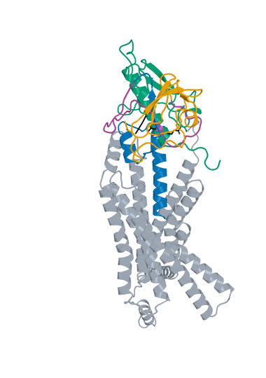

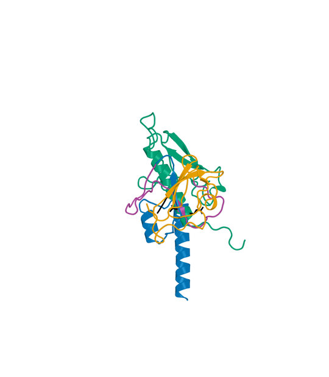

Figure 1. LK_P050_07, final rank 1: Boltz2 Exact native model 0, seed 101, candidate chain A with one 440-aa human GLP1R chain B. Left: receptor-complex view. Right: interface detail. LigandForge orange, generated linker purple and ECD binder blue. ECD A1-53  linker A54-82  LF A83-151. Black sticks mark receptor E34, Q37 and R40. Receptor ECD B1-105 (UniProt 24-128) is teal; remaining receptor is gray. The panels preserve their saved rigid receptor-core alignment and use different zooms. The detailed panel is a focused display and omits distal receptor context; all residues remain in the scored model.


## 5.02  LK_P063_07

Rank 2 | AP Novo linked fusion | 140 residues | Highest Exact ipSAE order retained

**Creation route.** AP Novo ECD generation and standalone Exact parent selection + original LigandForge generation and standalone Exact parent prediction -> recorded orientation and pair selection -> AP Novo linker generation -> complete fusion Exact refolding -> extracellular screen -> DeltaForge prediction.

### LK_P063_07: creation history

**ECD parent.** S08_03_083, suite apnovo_L20-40_linkerfixed, shard 3; 40 aa, standalone parent Exact rank 15.0, ipSAE 0.910317. The saved generator reference matches its component sequence. Its upstream R40 target context follows section 2.1.

**LigandForge parent.** Design_280, 69 aa, original standalone Exact rank 979.0, ipSAE 0.010649. Its original generated coordinates are unavailable. These parent scores describe standalone models, not the fused molecule.

**Exact fusion construction.** Pair P063; direction ECD->LF; AP Novo seed 738, native attempt 7. One-based inclusive boundaries: ECD A1-40; linker A41-71; LF A72-140. The 31-aa generated linker is `GMFVDPSEVLDPSPPPPPPLSLPPVPATDVV`; its allowed source range was 23-35 aa. Both parent sequences and the full linker are sequence-verified in the selected molecule; no unrecorded substitutions or terminal trimming were applied.

**Validation.** Complete fused chain A plus 440-aa receptor B, Exact seed 101, source native model 0. Post-refold free-C-terminal OPM z = 60.46 A; extracellular-margin check passed. This does not establish assay accessibility or activation.

**DeltaForge Kd:** 1.342597 nM, computational prediction for one full 140-aa candidate chain against one 440-aa GLP1R chain. Provider scope: platform_8_140; quotable prediction: True. The scorer and calibration are those in section 2.5.

**Exact selected sequence (N to C):**

```text
MEKKREDFKEVLKFRYSRYPSLDRFVLVNTAEESIRHLLIGMFVDPSEVLDPSPPPPPPLSLPPVPATDV
VEVSGATIDLRVKTCVDFKQTVNFFKLRNTQLPGSCTKDNTVLFLLEGLKLGYASRYFSIGSGSGSQQFS
```


## 5.02  LK_P063_07 - validation and provenance

**Current review.** Exact-sequence and scoring-input checks passed. Functional activation and measured Kd remain unavailable.

| Source and molecular scope | Metric | Value |
| --- | --- | --- |
| Boltz2 Exact / human / seed101 / model0 / A-B | ipSAE Type=max (PAE10, dist15) | 0.911264 |
| same native model | ipTM | 0.888502 |
| same native model | directional ipSAE A->B / B->A | 0.911264 / 0.660493 |
| same native model | fusion pLDDT / linker pLDDT (0-100) | 48.62 / 43.90 |
| same native model | ECD / LigandForge segment pLDDT (0-100) | 66.97 / 40.11 |
| generator versus Exact | complete fusion DockQ (self-consistency) | 0.2115 |
| DeltaForge / intact monomer + receptor | predicted Kd (nM) | 1.342597 |
| within-population top50 | predicted-Kd rank (separate from Exact rank) | 13 |
| Boltz2 Exact | pDockQ / pDockQ2 / LIS | 0.3717 / 0.2144 / 0.5409 |
| AP Novo versus Exact | fusion TM-score / receptor-core RMSD A | 0.3561 / 1.1332 |
| Boltz2 Exact | E34 / Q37 / R40 minimum side-chain distance A | 7.81 / 5.23 / 2.98 |
| Boltz2 Exact | max peptide C-N bond A / out-of-range count | 1.355 / 0 |
| DeltaForge | contacts / H bonds / salt bridges / hydrophobic contacts | 109 / 8 / 6 / 31 |

**Interpretation.** Whole-fusion and segment pLDDT expose uncertainty beyond the interface score. The standalone parent interfaces and fusion placement can differ, and no experimental structure validates the predicted geometry.


**Computational provenance.** ECD parent: suite apnovo_L20-40_linkerfixed, shard 3, output 083, shard seed start 401. Linker-generation run 2026-10-24_pair185-apnovo-linkers_004; accepted run 2026-10-24_pair183-extracellular-generation_001; Exact run 2026-10-24_pair183-extracellular-exact_001; ranking run 2026-10-25_linker-top100-ranking_002. Junction gap 65.867 A; actual context radius 10.0 A; 244 receptor-context residues; maximum assembled input 388 residues. Context input chains: A = native B1-130, B = native B166-219, C = native B260-262, E = native B264-292, F = native B343-370. Exact AP Novo motif: D1-40,23-35,L1-69/A1-130/B1-54/C1-3/E1-29/F1-28. Fixed-domain C-alpha RMSD after generation: 0.000492 A.

**Scientific identities (SHA-256).**

```text
S08_03_083 parent Exact
a27a3ebef4b6f84b9303525c977a31a147dd0e335c38280dd83e504fc01ec818
S08_03_083 parent AP Novo generator
d186554ae1007732daee855a3fa9f4d73bcd1b411996c914f20b270ba5ceec1b
Design_280 parent Exact
30aef35712822acd137e6b1a15aae02c4bace0383fe59446de7f5b8c27af09ff
AP Novo fixed-domain motif input
d473e6866eb5fcb6788a57a6e1f68465704df12b72196d00d0f24ea20d217a33
AP Novo fusion generator
c3f0ae072962d3cf9ecf30243b485496f10398c3d5b2a6033e513e12f31ed72b
Selected full sequence
b140a1ab7270fe482da2b10c10059ed8faeaa1903da534255877c1114414d485
Selected Boltz2 Exact model
bf7d45251c1117f8d3d61acb7256b8a07e9e9f305d30b8546530fea3ee6c1d82
DeltaForge scoring input
a469a2fb5f07b3ed5af8e2f935fb82e41afd2e11ab7d233ddd419853c0a5e2e5
```

## 5.02  LK_P063_07 - bound structures

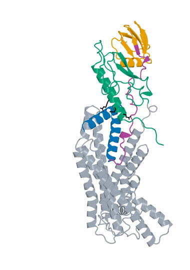

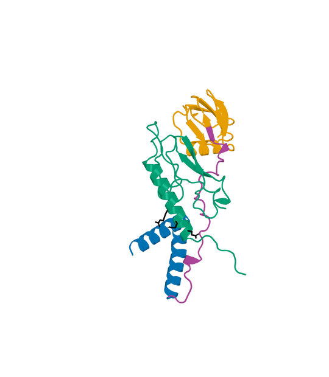

Figure 2. LK_P063_07, final rank 2: Boltz2 Exact native model 0, seed 101, candidate chain A with one 440-aa human GLP1R chain B. Left: receptor-complex view. Right: interface detail. LigandForge orange, generated linker purple and ECD binder blue. ECD A1-40  linker A41-71  LF A72-140. Black sticks mark receptor E34, Q37 and R40. Receptor ECD B1-105 (UniProt 24-128) is teal; remaining receptor is gray. The panels preserve their saved rigid receptor-core alignment and use different zooms. The detailed panel is a focused display and omits distal receptor context; all residues remain in the scored model.


## 5.03  LK_P109_06

Rank 3 | AP Novo linked fusion | 113 residues | Highest Exact ipSAE order retained

**Creation route.** AP Novo ECD generation and standalone Exact parent selection + original LigandForge generation and standalone Exact parent prediction -> recorded orientation and pair selection -> AP Novo linker generation -> complete fusion Exact refolding -> extracellular screen -> DeltaForge prediction.

### LK_P109_06: creation history

**ECD parent.** S08_00_099, suite apnovo_L20-40_linkerfixed, shard 0; 20 aa, standalone parent Exact rank 64.0, ipSAE 0.895549. The saved generator reference matches its component sequence. Its upstream R40 target context follows section 2.1.

**LigandForge parent.** Design_280, 69 aa, original standalone Exact rank 979.0, ipSAE 0.010649. Its original generated coordinates are unavailable. These parent scores describe standalone models, not the fused molecule.

**Exact fusion construction.** Pair P109; direction ECD->LF; AP Novo seed 1197, native attempt 6. One-based inclusive boundaries: ECD A1-20; linker A21-44; LF A45-113. The 24-aa generated linker is `GGRHRVGSGSSPPPPELAPEEVVK`; its allowed source range was 24-36 aa. Both parent sequences and the full linker are sequence-verified in the selected molecule; no unrecorded substitutions or terminal trimming were applied.

**Validation.** Complete fused chain A plus 440-aa receptor B, Exact seed 101, source native model 0. Post-refold free-C-terminal OPM z = 42.10 A; extracellular-margin check passed. This does not establish assay accessibility or activation.

**DeltaForge Kd:** 1.329380 nM, computational prediction for one full 113-aa candidate chain against one 440-aa GLP1R chain. Provider scope: core_40_119; quotable prediction: True. The scorer and calibration are those in section 2.5.

**Exact selected sequence (N to C):**

```text
MSFFQKYLKQLYLQECLSFLGGRHRVGSGSSPPPPELAPEEVVKEVSGATIDLRVKTCVDFKQTVNFFKL
RNTQLPGSCTKDNTVLFLLEGLKLGYASRYFSIGSGSGSQQFS
```


## 5.03  LK_P109_06 - validation and provenance

**Current review.** Exact-sequence and scoring-input checks passed. Functional activation and measured Kd remain unavailable.

| Source and molecular scope | Metric | Value |
| --- | --- | --- |
| Boltz2 Exact / human / seed101 / model0 / A-B | ipSAE Type=max (PAE10, dist15) | 0.910941 |
| same native model | ipTM | 0.871344 |
| same native model | directional ipSAE A->B / B->A | 0.910941 / 0.511794 |
| same native model | fusion pLDDT / linker pLDDT (0-100) | 51.83 / 51.96 |
| same native model | ECD / LigandForge segment pLDDT (0-100) | 78.39 / 44.09 |
| generator versus Exact | complete fusion DockQ (self-consistency) | 0.2167 |
| DeltaForge / intact monomer + receptor | predicted Kd (nM) | 1.329380 |
| within-population top50 | predicted-Kd rank (separate from Exact rank) | 12 |
| Boltz2 Exact | pDockQ / pDockQ2 / LIS | 0.4192 / 0.2887 / 0.4385 |
| AP Novo versus Exact | fusion TM-score / receptor-core RMSD A | 0.2682 / 1.4450 |
| Boltz2 Exact | E34 / Q37 / R40 minimum side-chain distance A | 4.70 / 3.32 / 4.25 |
| Boltz2 Exact | max peptide C-N bond A / out-of-range count | 1.329 / 0 |
| DeltaForge | contacts / H bonds / salt bridges / hydrophobic contacts | 60 / 8 / 7 / 19 |

**Interpretation.** Whole-fusion and segment pLDDT expose uncertainty beyond the interface score. The standalone parent interfaces and fusion placement can differ, and no experimental structure validates the predicted geometry.


**Computational provenance.** ECD parent: suite apnovo_L20-40_linkerfixed, shard 0, output 099, shard seed start 101. Linker-generation run 2026-10-24_pair185-apnovo-linkers_004; accepted run 2026-10-24_pair183-extracellular-generation_001; Exact run 2026-10-24_pair183-extracellular-exact_001; ranking run 2026-10-25_linker-top100-ranking_002. Junction gap 69.360 A; actual context radius 10.0 A; 249 receptor-context residues; maximum assembled input 374 residues. Context input chains: A = native B1-131, B = native B165-199, C = native B202-219, E = native B260-262, F = native B264-266, G = native B268-291, H = native B293-295, I = native B339-345, J = native B348-372. Exact AP Novo motif: D1-20,24-36,L1-69/A1-131/B1-35/C1-18/E1-3/F1-3/G1-24/H1-3/I1-7/J1-25. Fixed-domain C-alpha RMSD after generation: 0.000500 A.

**Scientific identities (SHA-256).**

```text
S08_00_099 parent Exact
f867d36b4522712cdf4253f810003a648a5208e43046d9bb19ecd0d5b64ccee7
S08_00_099 parent AP Novo generator
a94622e71e5a09baed12dbe478e64d64d99011ba2112e43e9e1e3a537598a9b8
Design_280 parent Exact
30aef35712822acd137e6b1a15aae02c4bace0383fe59446de7f5b8c27af09ff
AP Novo fixed-domain motif input
b43f5396fba3ef8ad310bff6442036b3fbf4429cdfa129f6deac4f46e0cbcf47
AP Novo fusion generator
4e3bd136da9b9fadc77b3951677bfe6a823e745419b136460fa6524c7e656abe
Selected full sequence
afd8b79138f15686cbc7b0c99fcdc0293d6acf4b3dbc5a4ef47146111833281f
Selected Boltz2 Exact model
a0e496c74c9d41a7b0d164721515cdd9ec2ae2290b85ed8940015459349c3bde
DeltaForge scoring input
7484b0825ec7aec0de4c7019977550a206e37cdd9575d771296e8352dc1525be
```

## 5.03  LK_P109_06 - bound structures

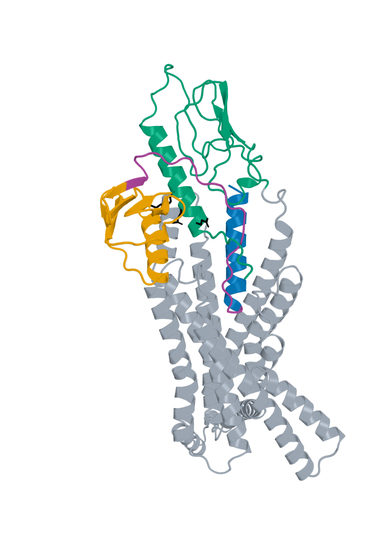

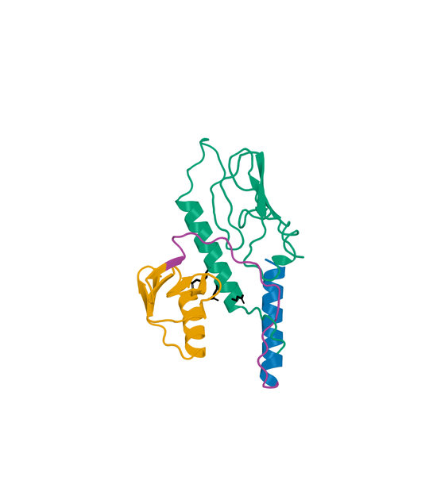

Figure 3. LK_P109_06, final rank 3: Boltz2 Exact native model 0, seed 101, candidate chain A with one 440-aa human GLP1R chain B. Left: receptor-complex view. Right: interface detail. LigandForge orange, generated linker purple and ECD binder blue. ECD A1-20  linker A21-44  LF A45-113. Black sticks mark receptor E34, Q37 and R40. Receptor ECD B1-105 (UniProt 24-128) is teal; remaining receptor is gray. The panels preserve their saved rigid receptor-core alignment and use different zooms. The detailed panel is a focused display and omits distal receptor context; all residues remain in the scored model.


## 5.04  Design_520

Rank 4 | original LigandForge | 53 residues | Highest Exact ipSAE order retained

**Creation route.** LigandForge Generation 1 -> exported full sequence with fixed GSGSGS and terminal four residues -> unconstrained 409-aa receptor Exact prediction -> saved DeltaForge prediction -> final filter and ranking.

### Design_520: creation history

**LigandForge generation.** Job 31e52bf6-d21e-448a-8633-da4073e20b3f, generator v6.5.21, provider export position 520. This position is distinct from original Exact rank 4. The complete assembled sequence is retained, including its GSGSGS suffix region and final four residues. The submitted-versus-featurized pocket uncertainty in section 2.1 applies. No generator coordinate comparison can be made.

**Exact sequence handoff.** The selected sequence matches the original exported record and completed original Exact population by SHA-256. No mutation, fusion, shortening, cyclization or imposed disulfide chemistry was added in this report.

**Validation.** Candidate chain A plus 409-aa receptor B, Exact seed 101, source native model 0; no hotspot constraints during complex prediction. The saved Exact model, scoring-PDB sequence and DeltaForge input identity reconcile.

**DeltaForge Kd:** 3.448637 nM, computational prediction for one full 53-aa candidate chain against one 409-aa GLP1R chain. Provider scope: core_40_119; quotable prediction: True. The scorer and calibration are those in section 2.5.

**Exact selected sequence (N to C):**

```text
QDVATDQGILTNVEAIFITNALYFTALLGFSDLCEARNAKKCVGSGSGSGLDR
```


## 5.04  Design_520 - validation and provenance

**Current review.** Exact-sequence and scoring-input checks passed. Functional activation and measured Kd remain unavailable.

| Source and molecular scope | Metric | Value |
| --- | --- | --- |
| Boltz2 Exact / human / seed101 / model0 / A-B | ipSAE Type=max (PAE10, dist15) | 0.910807 |
| same native model | ipTM | 0.926305 |
| same native model | complex pLDDT (native fraction) | 0.788865 |
| generator versus Exact | structural self-consistency | Unavailable: generator coordinates absent |
| DeltaForge / intact monomer + receptor | predicted Kd (nM) | 3.448637 |
| within-population top50 | predicted-Kd rank (separate from Exact rank) | 14 |
| DeltaForge | contacts / H bonds / salt bridges / hydrophobic contacts | 83 / 7 / 2 / 13 |

**Interpretation.** Interface scores and estimated affinity prioritize this exact sequence. They do not resolve the original generation pocket discrepancy or establish receptor activation.


**Computational provenance.** Original LigandForge job 31e52bf6-d21e-448a-8633-da4073e20b3f; vendor output 520; retained provider created-at 2026-10-15T23:00:47.301Z. Exact run 2026-10-15_ligandforge-exact_001; source population rank 4. The full sequence is the generator output supplied to Exact, with no redesign. Original generator coordinates and the submitted receptor bytes are unavailable.

**Additional generator predictions.** Provider immunogenicity risk 0.126 (grade C); MHC-I / MHC-II risk 0.11 / 0.104; proteolytic grade C; cleavage-site density 0.4832; N-end-rule proxy 10 min. These are provider predictions with no validation or uncertainty estimate in this study.

**Selected input identities (SHA-256).**

```text
Sequence
ae559fd47bdf75d2732e9a5bc4287501465abf222f0ac9fc466db9ad5c4ca41e
Boltz2 Exact native model
7fd320306aed5a85641570722ff84cd462fda1083c04fdfed46a84d7dba53376
DeltaForge scoring input
07fe8c2c25386e5bf495c2ebb636fcbaa6c4072673b2465beed511921dbf4beb
```


## 5.04  Design_520 - bound structures

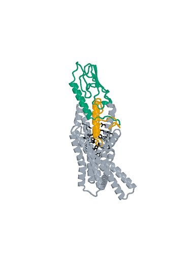

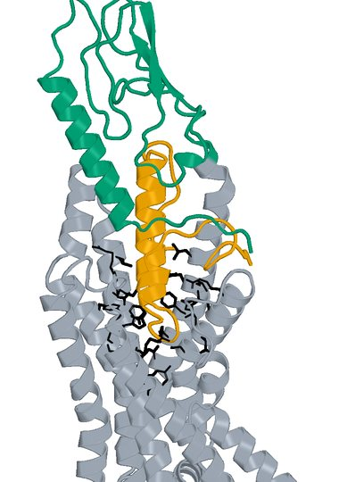

Figure 4. Design_520, final rank 4: Boltz2 Exact native model 0, seed 101, candidate chain A with one 409-aa human GLP1R chain B. Left: receptor-complex view. Right: interface detail. The complete 53-aa LigandForge chain A is orange. Black sticks mark the 27 submitted original pocket positions. Receptor ECD B1-105 (UniProt 24-128) is teal; remaining receptor is gray. The panels preserve their saved rigid receptor-core alignment and use different zooms. The detailed panel is a focused display and omits distal receptor context; all residues remain in the scored model.


## 5.05  LK_P088_08

Rank 5 | AP Novo linked fusion | 153 residues | Highest Exact ipSAE order retained

**Creation route.** AP Novo ECD generation and standalone Exact parent selection + original LigandForge generation and standalone Exact parent prediction -> recorded orientation and pair selection -> AP Novo linker generation -> complete fusion Exact refolding -> extracellular screen -> DeltaForge prediction.

### LK_P088_08: creation history

**ECD parent.** S11_03_093, suite apnovo_L40-60_linkerflex, shard 3; 52 aa, standalone parent Exact rank 43.0, ipSAE 0.902191. The saved generator reference matches its component sequence. Its upstream R40 target context follows section 2.1.

**LigandForge parent.** Design_280, 69 aa, original standalone Exact rank 979.0, ipSAE 0.010649. Its original generated coordinates are unavailable. These parent scores describe standalone models, not the fused molecule.

**Exact fusion construction.** Pair P088; direction LF->ECD; AP Novo seed 989, native attempt 8. One-based inclusive boundaries: LF A1-69; linker A70-101; ECD A102-153. The 32-aa generated linker is `SSSSTVTRRVPPPVNLLPWGPPSGQPFPRGLG`; its allowed source range was 22-34 aa. Both parent sequences and the full linker are sequence-verified in the selected molecule; no unrecorded substitutions or terminal trimming were applied.

**Validation.** Complete fused chain A plus 440-aa receptor B, Exact seed 101, source native model 0. Post-refold free-C-terminal OPM z = 34.03 A; extracellular-margin check passed. This does not establish assay accessibility or activation.

**DeltaForge Kd:** 0.718154 nM, computational prediction for one full 153-aa candidate chain against one 440-aa GLP1R chain. Provider scope: long_gt_140; quotable prediction: True. The scorer and calibration are those in section 2.5.

**Exact selected sequence (N to C):**

```text
EVSGATIDLRVKTCVDFKQTVNFFKLRNTQLPGSCTKDNTVLFLLEGLKLGYASRYFSIGSGSGSQQFSS
SSSTVTRRVPPPVNLLPWGPPSGQPFPRGLGMISELQELRRLFESSYPPYFSRLLWSSYLAASVGQSDLS
PTIGLGKALSASK
```


## 5.05  LK_P088_08 - validation and provenance

**Current review.** Exact-sequence and scoring-input checks passed. Functional activation and measured Kd remain unavailable.

| Source and molecular scope | Metric | Value |
| --- | --- | --- |
| Boltz2 Exact / human / seed101 / model0 / A-B | ipSAE Type=max (PAE10, dist15) | 0.907721 |
| same native model | ipTM | 0.882974 |
| same native model | directional ipSAE A->B / B->A | 0.907721 / 0.674131 |
| same native model | fusion pLDDT / linker pLDDT (0-100) | 45.79 / 39.79 |
| same native model | ECD / LigandForge segment pLDDT (0-100) | 56.61 / 40.42 |
| generator versus Exact | complete fusion DockQ (self-consistency) | 0.1394 |
| DeltaForge / intact monomer + receptor | predicted Kd (nM) | 0.718154 |
| within-population top50 | predicted-Kd rank (separate from Exact rank) | 1 |
| Boltz2 Exact | pDockQ / pDockQ2 / LIS | 0.2252 / 0.1339 / 0.5010 |
| AP Novo versus Exact | fusion TM-score / receptor-core RMSD A | 0.2459 / 0.8901 |
| Boltz2 Exact | E34 / Q37 / R40 minimum side-chain distance A | 7.05 / 10.03 / 8.40 |
| Boltz2 Exact | max peptide C-N bond A / out-of-range count | 1.338 / 0 |
| DeltaForge | contacts / H bonds / salt bridges / hydrophobic contacts | 85 / 8 / 3 / 14 |

**Interpretation.** Whole-fusion and segment pLDDT expose uncertainty beyond the interface score. The standalone parent interfaces and fusion placement can differ, and no experimental structure validates the predicted geometry.


**Computational provenance.** ECD parent: suite apnovo_L40-60_linkerflex, shard 3, output 093, shard seed start 401. Linker-generation run 2026-10-24_pair185-apnovo-linkers_004; accepted run 2026-10-24_pair183-extracellular-generation_001; Exact run 2026-10-24_pair183-extracellular-exact_001; ranking run 2026-10-25_linker-top100-ranking_002. Junction gap 64.124 A; actual context radius 10.0 A; 233 receptor-context residues; maximum assembled input 388 residues. Context input chains: A = native B1-135, B = native B166-199, C = native B202-215, E = native B260-262, F = native B264-266, G = native B268-284, H = native B286-288, I = native B347-370. Exact AP Novo motif: L1-69,22-34,D1-52/A1-135/B1-34/C1-14/E1-3/F1-3/G1-17/H1-3/I1-24. Fixed-domain C-alpha RMSD after generation: 0.000494 A.

**Scientific identities (SHA-256).**

```text
S11_03_093 parent Exact
4098f84b5c6c39381bf6ef2259a2e18b8e515e8e1cb4cd5b1543544518c929cd
S11_03_093 parent AP Novo generator
7086a79e4d2b25e11734f93b8ccff414ef05e660daa24ec5eb6e832693bff987
Design_280 parent Exact
30aef35712822acd137e6b1a15aae02c4bace0383fe59446de7f5b8c27af09ff
AP Novo fixed-domain motif input
735f69117b8c2050de609e7a9e06721af0af7fc66f55c58b902650fb44a92c22
AP Novo fusion generator
3a185b5a4c4b86c043dfeb43d7487167e266e9b5012c4070480d58063193a6ce
Selected full sequence
00df1a9681ade9f2d68bf7e6084ab615f661498a6b613a69c5c8e573bb9fc5b8
Selected Boltz2 Exact model
f96dc2a804c24cfdd89333ea654759c4338d783d7cd824bf3eac52c9b1e596cb
DeltaForge scoring input
cd9a4b745d9b42a929bcc916ea5e4a624933d81ddf3c5a07f4b7eb7aca8b6cb0
```

## 5.05  LK_P088_08 - bound structures

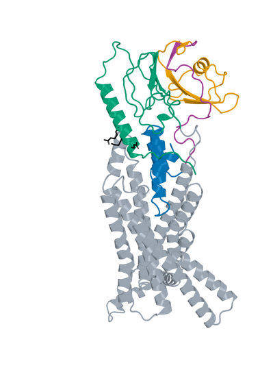

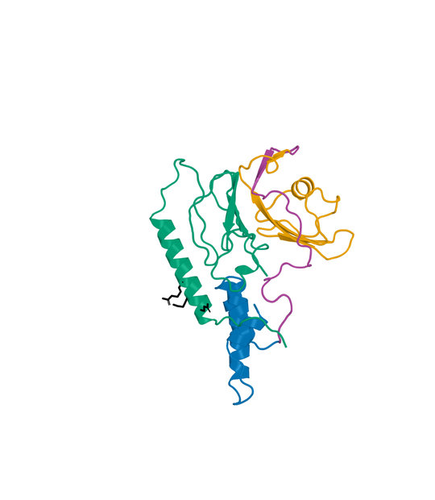

Figure 5. LK_P088_08, final rank 5: Boltz2 Exact native model 0, seed 101, candidate chain A with one 440-aa human GLP1R chain B. Left: receptor-complex view. Right: interface detail. LigandForge orange, generated linker purple and ECD binder blue. LF A1-69  linker A70-101  ECD A102-153. Black sticks mark receptor E34, Q37 and R40. Receptor ECD B1-105 (UniProt 24-128) is teal; remaining receptor is gray. The panels preserve their saved rigid receptor-core alignment and use different zooms. The detailed panel is a focused display and omits distal receptor context; all residues remain in the scored model.


## 5.06  LK_P050_03

Rank 6 | AP Novo linked fusion | 149 residues | Highest Exact ipSAE order retained

**Creation route.** AP Novo ECD generation and standalone Exact parent selection + original LigandForge generation and standalone Exact parent prediction -> recorded orientation and pair selection -> AP Novo linker generation -> complete fusion Exact refolding -> extracellular screen -> DeltaForge prediction.

### LK_P050_03: creation history

**ECD parent.** S11_02_089, suite apnovo_L40-60_linkerflex, shard 2; 53 aa, standalone parent Exact rank 2.0, ipSAE 0.926727. The saved generator reference matches its component sequence. Its upstream R40 target context follows section 2.1.

**LigandForge parent.** Design_280, 69 aa, original standalone Exact rank 979.0, ipSAE 0.010649. Its original generated coordinates are unavailable. These parent scores describe standalone models, not the fused molecule.

**Exact fusion construction.** Pair P050; direction ECD->LF; AP Novo seed 604, native attempt 3. One-based inclusive boundaries: ECD A1-53; linker A54-80; LF A81-149. The 27-aa generated linker is `GFDFVPSPTSSAPPLLCQGTEPAENTR`; its allowed source range was 25-37 aa. Both parent sequences and the full linker are sequence-verified in the selected molecule; no unrecorded substitutions or terminal trimming were applied.

**Validation.** Complete fused chain A plus 440-aa receptor B, Exact seed 101, source native model 0. Post-refold free-C-terminal OPM z = 38.34 A; extracellular-margin check passed. This does not establish assay accessibility or activation.

**DeltaForge Kd:** 3.279712 nM, computational prediction for one full 149-aa candidate chain against one 440-aa GLP1R chain. Provider scope: long_gt_140; quotable prediction: True. The scorer and calibration are those in section 2.5.

**Exact selected sequence (N to C):**

```text
MGISALEEFDRLRRASILLSLIRSGSTGSGFDAFLEKSGVKGAPAFLAVPSSNGFDFVPSPTSSAPPLLC
QGTEPAENTREVSGATIDLRVKTCVDFKQTVNFFKLRNTQLPGSCTKDNTVLFLLEGLKLGYASRYFSIG
SGSGSQQFS
```


## 5.06  LK_P050_03 - validation and provenance

**Current review.** Exact-sequence and scoring-input checks passed. Functional activation and measured Kd remain unavailable.

| Source and molecular scope | Metric | Value |
| --- | --- | --- |
| Boltz2 Exact / human / seed101 / model0 / A-B | ipSAE Type=max (PAE10, dist15) | 0.905966 |
| same native model | ipTM | 0.920365 |
| same native model | directional ipSAE A->B / B->A | 0.905966 / 0.767290 |
| same native model | fusion pLDDT / linker pLDDT (0-100) | 51.99 / 41.12 |
| same native model | ECD / LigandForge segment pLDDT (0-100) | 67.07 / 44.67 |
| generator versus Exact | complete fusion DockQ (self-consistency) | 0.2066 |
| DeltaForge / intact monomer + receptor | predicted Kd (nM) | 3.279712 |
| within-population top50 | predicted-Kd rank (separate from Exact rank) | 31 |
| Boltz2 Exact | pDockQ / pDockQ2 / LIS | 0.4071 / 0.2529 / 0.5035 |
| AP Novo versus Exact | fusion TM-score / receptor-core RMSD A | 0.2787 / 0.8735 |
| Boltz2 Exact | E34 / Q37 / R40 minimum side-chain distance A | 3.00 / 3.22 / 3.59 |
| Boltz2 Exact | max peptide C-N bond A / out-of-range count | 1.329 / 0 |
| DeltaForge | contacts / H bonds / salt bridges / hydrophobic contacts | 69 / 14 / 9 / 20 |

**Interpretation.** Whole-fusion and segment pLDDT expose uncertainty beyond the interface score. The standalone parent interfaces and fusion placement can differ, and no experimental structure validates the predicted geometry.


**Computational provenance.** ECD parent: suite apnovo_L40-60_linkerflex, shard 2, output 089, shard seed start 301. Linker-generation run 2026-10-24_pair185-apnovo-linkers_004; accepted run 2026-10-24_pair183-extracellular-generation_001; Exact run 2026-10-24_pair183-extracellular-exact_001; ranking run 2026-10-25_linker-top100-ranking_002. Junction gap 70.917 A; actual context radius 10.0 A; 266 receptor-context residues; maximum assembled input 425 residues. Context input chains: A = native B1-130, B = native B165-222, C = native B253-262, E = native B264-266, F = native B268-296, G = native B337-372. Exact AP Novo motif: D1-53,25-37,L1-69/A1-130/B1-58/C1-10/E1-3/F1-29/G1-36. Fixed-domain C-alpha RMSD after generation: 0.000485 A.

**Scientific identities (SHA-256).**

```text
S11_02_089 parent Exact
a1241a7436b64826fa86f52e727a7035efc10518462db650194766bac15838ee
S11_02_089 parent AP Novo generator
5c945ba2f8b55a7de827da90fce404e2a708162945915853fe933eca5e0a8ac9
Design_280 parent Exact
30aef35712822acd137e6b1a15aae02c4bace0383fe59446de7f5b8c27af09ff
AP Novo fixed-domain motif input
88c9090fd39d421927c79f1d7797d435774356d0ba4e344e7c04e23d1d29e059
AP Novo fusion generator
da805f8a18842fbb3db33d003cd96e4418329e1c47aaa73cff0b03e4a87d5f6c
Selected full sequence
3f52e9ffe4a9aa4e25918074b0463245934a22fc87c9def620a853f340dd3ba9
Selected Boltz2 Exact model
3501ffce18d848606153666f7594ee3d1d85e2ee6a1013f2d0ba58f4c5eadd01
DeltaForge scoring input
d93360b3c50b852e9269bba6b1707f687b0257ac127e970d1704a0ce605dddcc
```

## 5.06  LK_P050_03 - bound structures

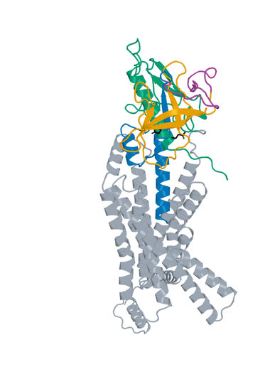

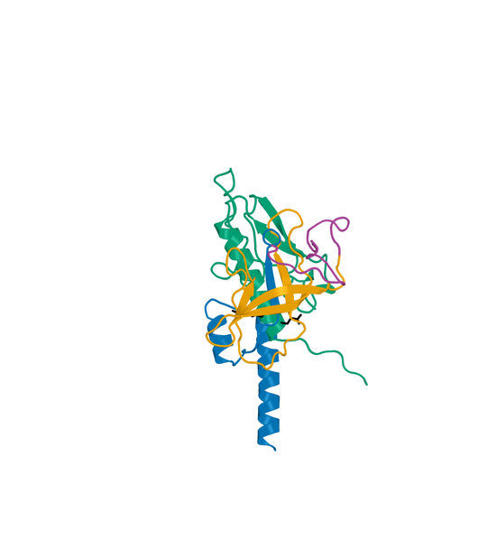

Figure 6. LK_P050_03, final rank 6: Boltz2 Exact native model 0, seed 101, candidate chain A with one 440-aa human GLP1R chain B. Left: receptor-complex view. Right: interface detail. LigandForge orange, generated linker purple and ECD binder blue. ECD A1-53  linker A54-80  LF A81-149. Black sticks mark receptor E34, Q37 and R40. Receptor ECD B1-105 (UniProt 24-128) is teal; remaining receptor is gray. The panels preserve their saved rigid receptor-core alignment and use different zooms. The detailed panel is a focused display and omits distal receptor context; all residues remain in the scored model.


## 5.07  Design_973

Rank 7 | original LigandForge | 65 residues | Highest Exact ipSAE order retained

**Creation route.** LigandForge Generation 1 -> exported full sequence with fixed GSGSGS and terminal four residues -> unconstrained 409-aa receptor Exact prediction -> saved DeltaForge prediction -> final filter and ranking.

### Design_973: creation history

**LigandForge generation.** Job 31e52bf6-d21e-448a-8633-da4073e20b3f, generator v6.5.21, provider export position 973. This position is distinct from original Exact rank 8. The complete assembled sequence is retained, including its GSGSGS suffix region and final four residues. The submitted-versus-featurized pocket uncertainty in section 2.1 applies. No generator coordinate comparison can be made.

**Exact sequence handoff.** The selected sequence matches the original exported record and completed original Exact population by SHA-256. No mutation, fusion, shortening, cyclization or imposed disulfide chemistry was added in this report.

**Validation.** Candidate chain A plus 409-aa receptor B, Exact seed 101, source native model 0; no hotspot constraints during complex prediction. The saved Exact model, scoring-PDB sequence and DeltaForge input identity reconcile.

**DeltaForge Kd:** 0.619164 nM, computational prediction for one full 65-aa candidate chain against one 409-aa GLP1R chain. Provider scope: core_40_119; quotable prediction: True. The scorer and calibration are those in section 2.5.

**Exact selected sequence (N to C):**

```text
SKCTLHALETSFTVDPKGRFKIIAEEFSRTILGCKLLENAKFLYVVGFTEAVNLSGSGSGSPFDR
```


## 5.07  Design_973 - validation and provenance

**Current review.** Exact-sequence and scoring-input checks passed. Functional activation and measured Kd remain unavailable.

| Source and molecular scope | Metric | Value |
| --- | --- | --- |
| Boltz2 Exact / human / seed101 / model0 / A-B | ipSAE Type=max (PAE10, dist15) | 0.903800 |
| same native model | ipTM | 0.948061 |
| same native model | complex pLDDT (native fraction) | 0.768306 |
| generator versus Exact | structural self-consistency | Unavailable: generator coordinates absent |
| DeltaForge / intact monomer + receptor | predicted Kd (nM) | 0.619164 |
| within-population top50 | predicted-Kd rank (separate from Exact rank) | 1 |
| DeltaForge | contacts / H bonds / salt bridges / hydrophobic contacts | 76 / 8 / 3 / 20 |

**Interpretation.** Interface scores and estimated affinity prioritize this exact sequence. They do not resolve the original generation pocket discrepancy or establish receptor activation.


**Computational provenance.** Original LigandForge job 31e52bf6-d21e-448a-8633-da4073e20b3f; vendor output 973; retained provider created-at 2026-10-15T23:00:52.146Z. Exact run 2026-10-15_ligandforge-exact_001; source population rank 8. The full sequence is the generator output supplied to Exact, with no redesign. Original generator coordinates and the submitted receptor bytes are unavailable.

**Additional generator predictions.** Provider immunogenicity risk 0.138 (grade C); MHC-I / MHC-II risk 0.115 / 0.137; proteolytic grade D; cleavage-site density 0.5229; N-end-rule proxy 1200 min. These are provider predictions with no validation or uncertainty estimate in this study.

**Selected input identities (SHA-256).**

```text
Sequence
d58d873a366590fcf1713fc2585c8eb724259d7d5e878f81b37a650dda2e3149
Boltz2 Exact native model
2f7a42d2398a58ae72f865082414e8bdeb86aaf5ff428f9d3caa8abf2f0ba554
DeltaForge scoring input
1ac777d39b5ba7521aaaf2b08830ab6b3907f5dde3336ba94396301931d3cfbe
```


## 5.07  Design_973 - bound structures

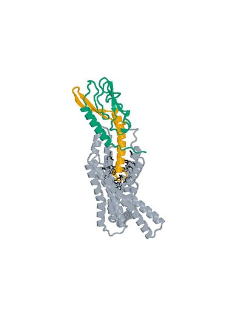

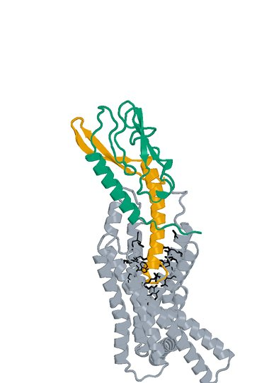

Figure 7. Design_973, final rank 7: Boltz2 Exact native model 0, seed 101, candidate chain A with one 409-aa human GLP1R chain B. Left: receptor-complex view. Right: interface detail. The complete 65-aa LigandForge chain A is orange. Black sticks mark the 27 submitted original pocket positions. Receptor ECD B1-105 (UniProt 24-128) is teal; remaining receptor is gray. The panels preserve their saved rigid receptor-core alignment and use different zooms. The detailed panel is a focused display and omits distal receptor context; all residues remain in the scored model.


## 5.08  LK_P157_08

Rank 8 | AP Novo linked fusion | 139 residues | Highest Exact ipSAE order retained

**Creation route.** AP Novo ECD generation and standalone Exact parent selection + original LigandForge generation and standalone Exact parent prediction -> recorded orientation and pair selection -> AP Novo linker generation -> complete fusion Exact refolding -> extracellular screen -> DeltaForge prediction.

### LK_P157_08: creation history

**ECD parent.** S10_02_023, suite apnovo_L40-60_linkerfixed, shard 2; 50 aa, standalone parent Exact rank 21.0, ipSAE 0.907116. The saved generator reference matches its component sequence. Its upstream R40 target context follows section 2.1.

**LigandForge parent.** Design_414, 54 aa, original standalone Exact rank 990.0, ipSAE 0.000000. Its original generated coordinates are unavailable. These parent scores describe standalone models, not the fused molecule.

**Exact fusion construction.** Pair P157; direction ECD->LF; AP Novo seed 1679, native attempt 8. One-based inclusive boundaries: ECD A1-50; linker A51-85; LF A86-139. The 35-aa generated linker is `GGTDSLGKGSYDDKLNALPFSPEAEAAAQKDVEAG`; its allowed source range was 24-36 aa. Both parent sequences and the full linker are sequence-verified in the selected molecule; no unrecorded substitutions or terminal trimming were applied.

**Validation.** Complete fused chain A plus 440-aa receptor B, Exact seed 101, source native model 0. Post-refold free-C-terminal OPM z = 76.82 A; extracellular-margin check passed. This does not establish assay accessibility or activation.

**DeltaForge Kd:** 3.242609 nM, computational prediction for one full 139-aa candidate chain against one 440-aa GLP1R chain. Provider scope: platform_8_140; quotable prediction: True. The scorer and calibration are those in section 2.5.

**Exact selected sequence (N to C):**

```text
MSIDYSSLVTHSPTGVAEATEFLYRYYQLREIPLETFIAVASALYHSSLLGGTDSLGKGSYDDKLNALPF
SPEAEAAAQKDVEAGKTKEGSSCVRGGSRTELFSKEPDKGVSFVSGSGVEYVCFAFFVVGSGSGSTYVS
```


## 5.08  LK_P157_08 - validation and provenance

**Current review.** Exact-sequence and scoring-input checks passed. Functional activation and measured Kd remain unavailable.

| Source and molecular scope | Metric | Value |
| --- | --- | --- |
| Boltz2 Exact / human / seed101 / model0 / A-B | ipSAE Type=max (PAE10, dist15) | 0.902451 |
| same native model | ipTM | 0.887932 |
| same native model | directional ipSAE A->B / B->A | 0.902451 / 0.595528 |
| same native model | fusion pLDDT / linker pLDDT (0-100) | 54.18 / 46.34 |
| same native model | ECD / LigandForge segment pLDDT (0-100) | 57.51 / 56.17 |
| generator versus Exact | complete fusion DockQ (self-consistency) | 0.1548 |
| DeltaForge / intact monomer + receptor | predicted Kd (nM) | 3.242609 |
| within-population top50 | predicted-Kd rank (separate from Exact rank) | 30 |
| Boltz2 Exact | pDockQ / pDockQ2 / LIS | 0.3145 / 0.1314 / 0.5288 |
| AP Novo versus Exact | fusion TM-score / receptor-core RMSD A | 0.2560 / 1.2286 |
| Boltz2 Exact | E34 / Q37 / R40 minimum side-chain distance A | 7.67 / 5.18 / 6.62 |
| Boltz2 Exact | max peptide C-N bond A / out-of-range count | 1.360 / 0 |
| DeltaForge | contacts / H bonds / salt bridges / hydrophobic contacts | 120 / 12 / 3 / 27 |

**Interpretation.** Whole-fusion and segment pLDDT expose uncertainty beyond the interface score. The standalone parent interfaces and fusion placement can differ, and no experimental structure validates the predicted geometry.


**Computational provenance.** ECD parent: suite apnovo_L40-60_linkerfixed, shard 2, output 023, shard seed start 301. Linker-generation run 2026-10-24_pair185-apnovo-linkers_004; accepted run 2026-10-24_pair183-extracellular-generation_001; Exact run 2026-10-24_pair183-extracellular-exact_001; ranking run 2026-10-25_linker-top100-ranking_002. Junction gap 67.557 A; actual context radius 10.0 A; 264 receptor-context residues; maximum assembled input 404 residues. Context input chains: A = native B1-130, B = native B163-200, C = native B202-222, E = native B256-262, F = native B264-266, G = native B268-296, H = native B337-372. Exact AP Novo motif: D1-50,24-36,L1-54/A1-130/B1-38/C1-21/E1-7/F1-3/G1-29/H1-36. Fixed-domain C-alpha RMSD after generation: 0.000489 A.

**Scientific identities (SHA-256).**

```text
S10_02_023 parent Exact
6a0099ec45266f4285f77e1a54fa4ac9fd036b81785b9f59e1789d90a3467a1a
S10_02_023 parent AP Novo generator
a2aa05057701e99d19d2ed0a40dcb82cdab8d56dba0f1ffcb355dde8bc18bfaa
Design_414 parent Exact
5a4b6135513669b04ab6fcbdf702474485579a79ac65720f62507d120a8a908a
AP Novo fixed-domain motif input
a54f64723c76db600315d881518014f15713f9c518170e4f40a5c49b68b0a2e1
AP Novo fusion generator
2b723ee336a3a66b203777864d2c9fd288a6796214af4025b9569b5183c584e0
Selected full sequence
a6b21c268973d6aca8428dc32538891704af6a07a7a357b3de8a1856d194cc78
Selected Boltz2 Exact model
f9efc503df7abaf13c7f3bbea2af38254a6c142412d6ad515e3f59ce28a7bf7b
DeltaForge scoring input
80c7ec071ec58a7464df6de072e9017cfbebd6871775205cf042ad116cb3169b
```

## 5.08  LK_P157_08 - bound structures

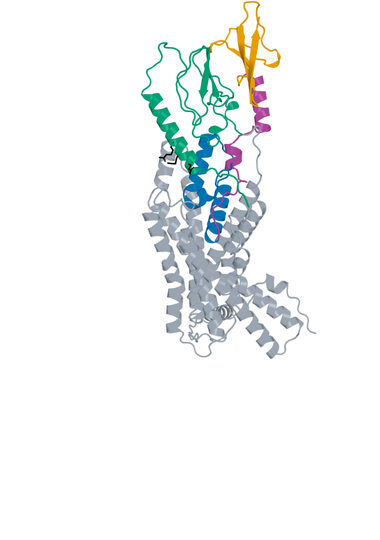

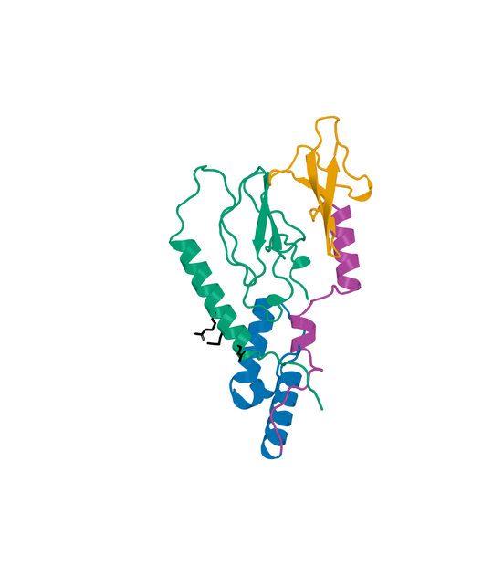

Figure 8. LK_P157_08, final rank 8: Boltz2 Exact native model 0, seed 101, candidate chain A with one 440-aa human GLP1R chain B. Left: receptor-complex view. Right: interface detail. LigandForge orange, generated linker purple and ECD binder blue. ECD A1-50  linker A51-85  LF A86-139. Black sticks mark receptor E34, Q37 and R40. Receptor ECD B1-105 (UniProt 24-128) is teal; remaining receptor is gray. The panels preserve their saved rigid receptor-core alignment and use different zooms. The detailed panel is a focused display and omits distal receptor context; all residues remain in the scored model.


## 5.09  LK_P069_04

Rank 9 | AP Novo linked fusion | 154 residues | Highest Exact ipSAE order retained

**Creation route.** AP Novo ECD generation and standalone Exact parent selection + original LigandForge generation and standalone Exact parent prediction -> recorded orientation and pair selection -> AP Novo linker generation -> complete fusion Exact refolding -> extracellular screen -> DeltaForge prediction.

### LK_P069_04: creation history

**ECD parent.** S10_02_023, suite apnovo_L40-60_linkerfixed, shard 2; 50 aa, standalone parent Exact rank 21.0, ipSAE 0.907116. The saved generator reference matches its component sequence. Its upstream R40 target context follows section 2.1.

**LigandForge parent.** Design_280, 69 aa, original standalone Exact rank 979.0, ipSAE 0.010649. Its original generated coordinates are unavailable. These parent scores describe standalone models, not the fused molecule.

**Exact fusion construction.** Pair P069; direction ECD->LF; AP Novo seed 795, native attempt 4. One-based inclusive boundaries: ECD A1-50; linker A51-85; LF A86-154. The 35-aa generated linker is `GGLGEFSDNGLPPVAPLPPGLPVPDLPQDEESDIK`; its allowed source range was 25-37 aa. Both parent sequences and the full linker are sequence-verified in the selected molecule; no unrecorded substitutions or terminal trimming were applied.

**Validation.** Complete fused chain A plus 440-aa receptor B, Exact seed 101, source native model 0. Post-refold free-C-terminal OPM z = 48.54 A; extracellular-margin check passed. This does not establish assay accessibility or activation.

**DeltaForge Kd:** 1.246506 nM, computational prediction for one full 154-aa candidate chain against one 440-aa GLP1R chain. Provider scope: long_gt_140; quotable prediction: True. The scorer and calibration are those in section 2.5.

**Exact selected sequence (N to C):**

```text
MSIDYSSLVTHSPTGVAEATEFLYRYYQLREIPLETFIAVASALYHSSLLGGLGEFSDNGLPPVAPLPPG
LPVPDLPQDEESDIKEVSGATIDLRVKTCVDFKQTVNFFKLRNTQLPGSCTKDNTVLFLLEGLKLGYASR
YFSIGSGSGSQQFS
```


## 5.09  LK_P069_04 - validation and provenance

**Current review.** Exact-sequence and scoring-input checks passed. Functional activation and measured Kd remain unavailable.

| Source and molecular scope | Metric | Value |
| --- | --- | --- |
| Boltz2 Exact / human / seed101 / model0 / A-B | ipSAE Type=max (PAE10, dist15) | 0.901831 |
| same native model | ipTM | 0.896967 |
| same native model | directional ipSAE A->B / B->A | 0.901831 / 0.689508 |
| same native model | fusion pLDDT / linker pLDDT (0-100) | 47.09 / 40.46 |
| same native model | ECD / LigandForge segment pLDDT (0-100) | 61.36 / 40.12 |
| generator versus Exact | complete fusion DockQ (self-consistency) | 0.1204 |
| DeltaForge / intact monomer + receptor | predicted Kd (nM) | 1.246506 |
| within-population top50 | predicted-Kd rank (separate from Exact rank) | 11 |
| Boltz2 Exact | pDockQ / pDockQ2 / LIS | 0.2443 / 0.1578 / 0.5079 |
| AP Novo versus Exact | fusion TM-score / receptor-core RMSD A | 0.3599 / 1.1388 |
| Boltz2 Exact | E34 / Q37 / R40 minimum side-chain distance A | 4.79 / 3.48 / 2.37 |
| Boltz2 Exact | max peptide C-N bond A / out-of-range count | 1.335 / 0 |
| DeltaForge | contacts / H bonds / salt bridges / hydrophobic contacts | 89 / 18 / 7 / 27 |

**Interpretation.** Whole-fusion and segment pLDDT expose uncertainty beyond the interface score. The standalone parent interfaces and fusion placement can differ, and no experimental structure validates the predicted geometry.


**Computational provenance.** ECD parent: suite apnovo_L40-60_linkerfixed, shard 2, output 023, shard seed start 301. Linker-generation run 2026-10-24_pair185-apnovo-linkers_004; accepted run 2026-10-24_pair183-extracellular-generation_001; Exact run 2026-10-24_pair183-extracellular-exact_001; ranking run 2026-10-25_linker-top100-ranking_002. Junction gap 72.173 A; actual context radius 10.0 A; 264 receptor-context residues; maximum assembled input 420 residues. Context input chains: A = native B1-130, B = native B163-200, C = native B202-222, E = native B256-262, F = native B264-266, G = native B268-296, H = native B337-372. Exact AP Novo motif: D1-50,25-37,L1-69/A1-130/B1-38/C1-21/E1-7/F1-3/G1-29/H1-36. Fixed-domain C-alpha RMSD after generation: 0.000508 A.

**Scientific identities (SHA-256).**

```text
S10_02_023 parent Exact
6a0099ec45266f4285f77e1a54fa4ac9fd036b81785b9f59e1789d90a3467a1a
S10_02_023 parent AP Novo generator
a2aa05057701e99d19d2ed0a40dcb82cdab8d56dba0f1ffcb355dde8bc18bfaa
Design_280 parent Exact
30aef35712822acd137e6b1a15aae02c4bace0383fe59446de7f5b8c27af09ff
AP Novo fixed-domain motif input
125b5bd7921215f5b2abab9c13eab594e0e1c536673a66f47b2bff4faa8d4c24
AP Novo fusion generator
79f3ea7a7c0a7764609077943c9d26aab8e84c70fe6ec9dff481672959428d9d
Selected full sequence
eac1abc7772075c04cdccc8ea3450645db2201bbcb5c4688152dd71deecf0693
Selected Boltz2 Exact model
54a9810d3ee59227525a958e2f805ebc56a7d62119dee48fb1d16c141ec808c6
DeltaForge scoring input
4c929315bb090f2d7c37c8f337b315073e2b18e7ece616adb0af0077567d3124
```

## 5.09  LK_P069_04 - bound structures

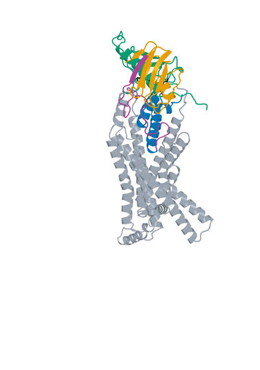

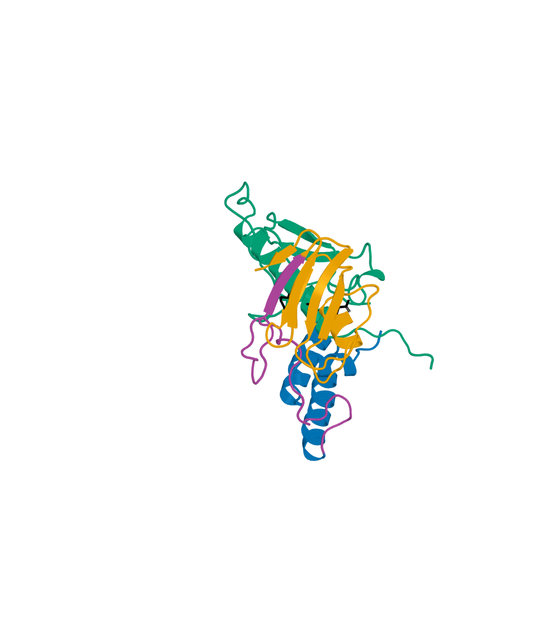

Figure 9. LK_P069_04, final rank 9: Boltz2 Exact native model 0, seed 101, candidate chain A with one 440-aa human GLP1R chain B. Left: receptor-complex view. Right: interface detail. LigandForge orange, generated linker purple and ECD binder blue. ECD A1-50  linker A51-85  LF A86-154. Black sticks mark receptor E34, Q37 and R40. Receptor ECD B1-105 (UniProt 24-128) is teal; remaining receptor is gray. The panels preserve their saved rigid receptor-core alignment and use different zooms. The detailed panel is a focused display and omits distal receptor context; all residues remain in the scored model.


## 5.10  LK_P024_03

Rank 10 | AP Novo linked fusion | 128 residues | Highest Exact ipSAE order retained

**Creation route.** AP Novo ECD generation and standalone Exact parent selection + original LigandForge generation and standalone Exact parent prediction -> recorded orientation and pair selection -> AP Novo linker generation -> complete fusion Exact refolding -> extracellular screen -> DeltaForge prediction.

### LK_P024_03: creation history

**ECD parent.** S11_00_040, suite apnovo_L40-60_linkerflex, shard 0; 48 aa, standalone parent Exact rank 17.0, ipSAE 0.909676. The saved generator reference matches its component sequence. Its upstream R40 target context follows section 2.1.

**LigandForge parent.** Design_613, 62 aa, original standalone Exact rank 970.0, ipSAE 0.011681. Its original generated coordinates are unavailable. These parent scores describe standalone models, not the fused molecule.

**Exact fusion construction.** Pair P024; direction ECD->LF; AP Novo seed 344, native attempt 3. One-based inclusive boundaries: ECD A1-48; linker A49-66; LF A67-128. The 18-aa generated linker is `GGHRVEPPVRPPPVSLPG`; its allowed source range was 16-28 aa. Both parent sequences and the full linker are sequence-verified in the selected molecule; no unrecorded substitutions or terminal trimming were applied.

**Validation.** Complete fused chain A plus 440-aa receptor B, Exact seed 101, source native model 0. Post-refold free-C-terminal OPM z = 39.32 A; extracellular-margin check passed. This does not establish assay accessibility or activation.

**DeltaForge Kd:** 3.788904 nM, computational prediction for one full 128-aa candidate chain against one 440-aa GLP1R chain. Provider scope: platform_8_140; quotable prediction: True. The scorer and calibration are those in section 2.5.

**Exact selected sequence (N to C):**

```text
MRALAQASTGSSALETLHRMRVEAFFQQQLRSGTLSDGAVEAYSRLVGGGHRVEPPVRPPPVSLPGRTCT
SAYGVPYSDGHFQRPVPSENGLNTQGVTDVSGRETDESTDVFVVISCQGSGSGSTRFN
```


## 5.10  LK_P024_03 - validation and provenance

**Current review.** Exact-sequence and scoring-input checks passed. Functional activation and measured Kd remain unavailable.

| Source and molecular scope | Metric | Value |
| --- | --- | --- |
| Boltz2 Exact / human / seed101 / model0 / A-B | ipSAE Type=max (PAE10, dist15) | 0.901677 |
| same native model | ipTM | 0.870594 |
| same native model | directional ipSAE A->B / B->A | 0.901677 / 0.561484 |
| same native model | fusion pLDDT / linker pLDDT (0-100) | 57.31 / 51.46 |
| same native model | ECD / LigandForge segment pLDDT (0-100) | 69.26 / 49.76 |
| generator versus Exact | complete fusion DockQ (self-consistency) | 0.2143 |
| DeltaForge / intact monomer + receptor | predicted Kd (nM) | 3.788904 |
| within-population top50 | predicted-Kd rank (separate from Exact rank) | 33 |
| Boltz2 Exact | pDockQ / pDockQ2 / LIS | 0.3381 / 0.2317 / 0.4666 |
| AP Novo versus Exact | fusion TM-score / receptor-core RMSD A | 0.3514 / 0.9075 |
| Boltz2 Exact | E34 / Q37 / R40 minimum side-chain distance A | 6.02 / 6.52 / 2.88 |
| Boltz2 Exact | max peptide C-N bond A / out-of-range count | 1.349 / 0 |
| DeltaForge | contacts / H bonds / salt bridges / hydrophobic contacts | 65 / 11 / 8 / 16 |

**Interpretation.** Whole-fusion and segment pLDDT expose uncertainty beyond the interface score. The standalone parent interfaces and fusion placement can differ, and no experimental structure validates the predicted geometry.


**Computational provenance.** ECD parent: suite apnovo_L40-60_linkerflex, shard 0, output 040, shard seed start 101. Linker-generation run 2026-10-24_pair185-apnovo-linkers_004; accepted run 2026-10-24_pair183-extracellular-generation_001; Exact run 2026-10-24_pair183-extracellular-exact_001; ranking run 2026-10-25_linker-top100-ranking_002. Junction gap 46.731 A; actual context radius 10.0 A; 246 receptor-context residues; maximum assembled input 384 residues. Context input chains: A = native B1-130, B = native B165-219, C = native B260-262, E = native B264-266, F = native B268-291, G = native B340-370. Exact AP Novo motif: D1-48,16-28,L1-62/A1-130/B1-55/C1-3/E1-3/F1-24/G1-31. Fixed-domain C-alpha RMSD after generation: 0.000480 A.

**Scientific identities (SHA-256).**

```text
S11_00_040 parent Exact
b30ef4faf7be808cc92852f3533e62d4c47461a9a99d3d3ebd733af32ed5e734
S11_00_040 parent AP Novo generator
4bf6b218944af7d38863e8105d4b53735d293c0d50969e7d7817a008af0bfcee
Design_613 parent Exact
38f42c2f8ed327bc2e10d5798687062273ae7a2a802051cfb28e828a882bbe16
AP Novo fixed-domain motif input
e8917d9a12993c1e1ce5babe52afa60b2eb8c8144b96b14f9f07cc63cc71222e
AP Novo fusion generator
d7a9b3996e7e32bd9cbdfee51658c758e9107fc95ee6e53b1fa3b23ecc8922a7
Selected full sequence
8dc9b6cdcee3e7e71a77d1467efe1238ae3ac5e5f038f9f11c9d2bddd853a214
Selected Boltz2 Exact model
4fc14c3d8396a86eafcb4fcc7dfea43f4735fa0f1a97b442e4e297d2c289df24
DeltaForge scoring input
dfb21db83d1128f2f2827422ca25d2545fcaf850845839b44f89539a3731148b
```

## 5.10  LK_P024_03 - bound structures

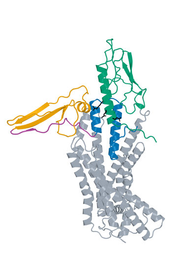

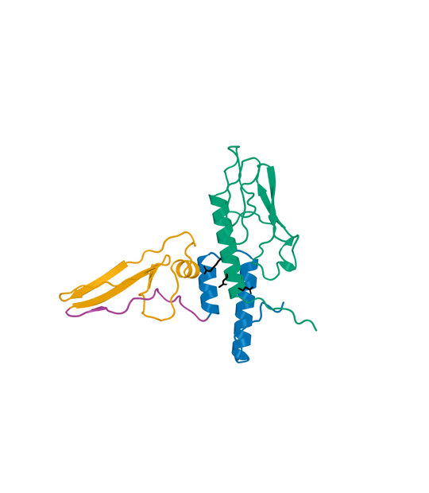

Figure 10. LK_P024_03, final rank 10: Boltz2 Exact native model 0, seed 101, candidate chain A with one 440-aa human GLP1R chain B. Left: receptor-complex view. Right: interface detail. LigandForge orange, generated linker purple and ECD binder blue. ECD A1-48  linker A49-66  LF A67-128. Black sticks mark receptor E34, Q37 and R40. Receptor ECD B1-105 (UniProt 24-128) is teal; remaining receptor is gray. The panels preserve their saved rigid receptor-core alignment and use different zooms. The detailed panel is a focused display and omits distal receptor context; all residues remain in the scored model.


## 5.11  Design_994

Rank 11 | original LigandForge | 70 residues | Highest Exact ipSAE order retained

**Creation route.** LigandForge Generation 1 -> exported full sequence with fixed GSGSGS and terminal four residues -> unconstrained 409-aa receptor Exact prediction -> saved DeltaForge prediction -> final filter and ranking.

### Design_994: creation history

**LigandForge generation.** Job 31e52bf6-d21e-448a-8633-da4073e20b3f, generator v6.5.21, provider export position 994. This position is distinct from original Exact rank 11. The complete assembled sequence is retained, including its GSGSGS suffix region and final four residues. The submitted-versus-featurized pocket uncertainty in section 2.1 applies. No generator coordinate comparison can be made.

**Exact sequence handoff.** The selected sequence matches the original exported record and completed original Exact population by SHA-256. No mutation, fusion, shortening, cyclization or imposed disulfide chemistry was added in this report.

**Validation.** Candidate chain A plus 409-aa receptor B, Exact seed 101, source native model 0; no hotspot constraints during complex prediction. The saved Exact model, scoring-PDB sequence and DeltaForge input identity reconcile.

**DeltaForge Kd:** 2.737982 nM, computational prediction for one full 70-aa candidate chain against one 409-aa GLP1R chain. Provider scope: core_40_119; quotable prediction: True. The scorer and calibration are those in section 2.5.

**Exact selected sequence (N to C):**

```text
TIDGYKHLFEISDVIEAEGGELQLKRQEYESAIGFKLCRLNAESVYNVKKLSGLRPVGCKGSGSGSYVNL
```


## 5.11  Design_994 - validation and provenance

**Current review.** Exact-sequence and scoring-input checks passed. Functional activation and measured Kd remain unavailable.

| Source and molecular scope | Metric | Value |
| --- | --- | --- |
| Boltz2 Exact / human / seed101 / model0 / A-B | ipSAE Type=max (PAE10, dist15) | 0.900959 |
| same native model | ipTM | 0.955308 |
| same native model | complex pLDDT (native fraction) | 0.744261 |
| generator versus Exact | structural self-consistency | Unavailable: generator coordinates absent |
| DeltaForge / intact monomer + receptor | predicted Kd (nM) | 2.737982 |
| within-population top50 | predicted-Kd rank (separate from Exact rank) | 12 |
| DeltaForge | contacts / H bonds / salt bridges / hydrophobic contacts | 87 / 13 / 5 / 13 |

**Interpretation.** Interface scores and estimated affinity prioritize this exact sequence. They do not resolve the original generation pocket discrepancy or establish receptor activation.


**Computational provenance.** Original LigandForge job 31e52bf6-d21e-448a-8633-da4073e20b3f; vendor output 994; retained provider created-at 2026-10-15T23:00:53.074Z. Exact run 2026-10-15_ligandforge-exact_001; source population rank 11. The full sequence is the generator output supplied to Exact, with no redesign. Original generator coordinates and the submitted receptor bytes are unavailable.

**Additional generator predictions.** Provider immunogenicity risk 0.097 (grade B); MHC-I / MHC-II risk 0.1 / 0.057; proteolytic grade C; cleavage-site density 0.4894; N-end-rule proxy 420 min. These are provider predictions with no validation or uncertainty estimate in this study.

**Selected input identities (SHA-256).**

```text
Sequence
799f19539f7ce40757ac276419bda54c2548f8cdfffae59f8d86bc67fa50aa17
Boltz2 Exact native model
23fffdccdb4b68471c9b243b9ef27714eb55e616644fe4e2f98483c3879579c6
DeltaForge scoring input
195a001cf363948c1aea8e3d2c9802985e9597371143a7269596f0fd83555e92
```


## 5.11  Design_994 - bound structures

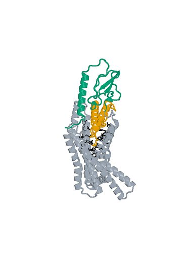

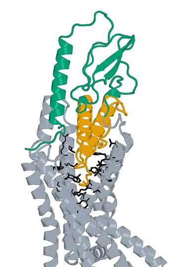

Figure 11. Design_994, final rank 11: Boltz2 Exact native model 0, seed 101, candidate chain A with one 409-aa human GLP1R chain B. Left: receptor-complex view. Right: interface detail. The complete 70-aa LigandForge chain A is orange. Black sticks mark the 27 submitted original pocket positions. Receptor ECD B1-105 (UniProt 24-128) is teal; remaining receptor is gray. The panels preserve their saved rigid receptor-core alignment and use different zooms. The detailed panel is a focused display and omits distal receptor context; all residues remain in the scored model.


## 5.12  LK_P012_08

Rank 12 | AP Novo linked fusion | 125 residues | Highest Exact ipSAE order retained

**Creation route.** AP Novo ECD generation and standalone Exact parent selection + original LigandForge generation and standalone Exact parent prediction -> recorded orientation and pair selection -> AP Novo linker generation -> complete fusion Exact refolding -> extracellular screen -> DeltaForge prediction.

### LK_P012_08: creation history

**ECD parent.** S08_00_042, suite apnovo_L20-40_linkerfixed, shard 0; 39 aa, standalone parent Exact rank 40.0, ipSAE 0.902628. The saved generator reference matches its component sequence. Its upstream R40 target context follows section 2.1.

**LigandForge parent.** Design_991, 65 aa, original standalone Exact rank 947.0, ipSAE 0.073587. Its original generated coordinates are unavailable. These parent scores describe standalone models, not the fused molecule.

**Exact fusion construction.** Pair P012; direction ECD->LF; AP Novo seed 229, native attempt 8. One-based inclusive boundaries: ECD A1-39; linker A40-60; LF A61-125. The 21-aa generated linker is `GGAPSFLPPPNVTSGYVNGGG`; its allowed source range was 15-27 aa. Both parent sequences and the full linker are sequence-verified in the selected molecule; no unrecorded substitutions or terminal trimming were applied.

**Validation.** Complete fused chain A plus 440-aa receptor B, Exact seed 101, source native model 0. Post-refold free-C-terminal OPM z = 34.03 A; extracellular-margin check passed. This does not establish assay accessibility or activation.

**DeltaForge Kd:** 1.444876 nM, computational prediction for one full 125-aa candidate chain against one 440-aa GLP1R chain. Provider scope: platform_8_140; quotable prediction: True. The scorer and calibration are those in section 2.5.

**Exact selected sequence (N to C):**

```text
MADSISEVSEGVHLILAAQALELPPFVVAARLEEARAKRGGAPSFLPPPNVTSGYVNGGGAFHLTGLAAR
CGAVWRGVFCQFGNGVKGEGSVTGGSLNTFYILTVAPTSANILTSGSGSGSLEGS
```


## 5.12  LK_P012_08 - validation and provenance

**Current review.** Exact-sequence and scoring-input checks passed. Functional activation and measured Kd remain unavailable.

| Source and molecular scope | Metric | Value |
| --- | --- | --- |
| Boltz2 Exact / human / seed101 / model0 / A-B | ipSAE Type=max (PAE10, dist15) | 0.900529 |
| same native model | ipTM | 0.917525 |
| same native model | directional ipSAE A->B / B->A | 0.900529 / 0.739589 |
| same native model | fusion pLDDT / linker pLDDT (0-100) | 47.90 / 41.65 |
| same native model | ECD / LigandForge segment pLDDT (0-100) | 67.41 / 38.22 |
| generator versus Exact | complete fusion DockQ (self-consistency) | 0.2160 |
| DeltaForge / intact monomer + receptor | predicted Kd (nM) | 1.444876 |
| within-population top50 | predicted-Kd rank (separate from Exact rank) | 14 |
| Boltz2 Exact | pDockQ / pDockQ2 / LIS | 0.2348 / 0.1121 / 0.5537 |
| AP Novo versus Exact | fusion TM-score / receptor-core RMSD A | 0.2889 / 0.9330 |
| Boltz2 Exact | E34 / Q37 / R40 minimum side-chain distance A | 6.36 / 5.08 / 3.10 |
| Boltz2 Exact | max peptide C-N bond A / out-of-range count | 1.330 / 0 |
| DeltaForge | contacts / H bonds / salt bridges / hydrophobic contacts | 114 / 10 / 9 / 32 |

**Interpretation.** Whole-fusion and segment pLDDT expose uncertainty beyond the interface score. The standalone parent interfaces and fusion placement can differ, and no experimental structure validates the predicted geometry.


**Computational provenance.** ECD parent: suite apnovo_L20-40_linkerfixed, shard 0, output 042, shard seed start 101. Linker-generation run 2026-10-24_pair185-apnovo-linkers_004; accepted run 2026-10-24_pair183-extracellular-generation_001; Exact run 2026-10-24_pair183-extracellular-exact_001; ranking run 2026-10-25_linker-top100-ranking_002. Junction gap 42.926 A; actual context radius 10.0 A; 258 receptor-context residues; maximum assembled input 389 residues. Context input chains: A = native B1-106, B = native B109-130, C = native B163-219, E = native B256-262, F = native B264-295, G = native B339-372. Exact AP Novo motif: D1-39,15-27,L1-65/A1-106/B1-22/C1-57/E1-7/F1-32/G1-34. Fixed-domain C-alpha RMSD after generation: 0.000495 A.

**Scientific identities (SHA-256).**

```text
S08_00_042 parent Exact
47158f64559e10c04f5ba9c937402e611695936805e4651d8419682b213f104f
S08_00_042 parent AP Novo generator
7b512af1937e4c7e65c796c47d3fe7f2c3a07fb057b645eefb6655bf46811c6b
Design_991 parent Exact
d8fee8dc32b9fc9e6718f04438f90db1ff271c9e01c8210a1d31944ac9918613
AP Novo fixed-domain motif input
cdda3d678589e1207bf352af647f8865139e26bb48ef60c4b17559fd3bc4a4e3
AP Novo fusion generator
cc1a56b9d46d26349880dde80d20f78d3e3bfd326db078ace24e9a2320620ee9
Selected full sequence
a8fa1d10358030cab72dca008ae0844ce42d6d4bafa0bd4d7d2b64643ef440c7
Selected Boltz2 Exact model
05354a48a6723a5e62d6a6d0700be933508e8986daad01fb8900ad828620a74d
DeltaForge scoring input
970fc5302535823051074742639b19f84f496d87c9928ba0760abc7cfa16a295
```

## 5.12  LK_P012_08 - bound structures

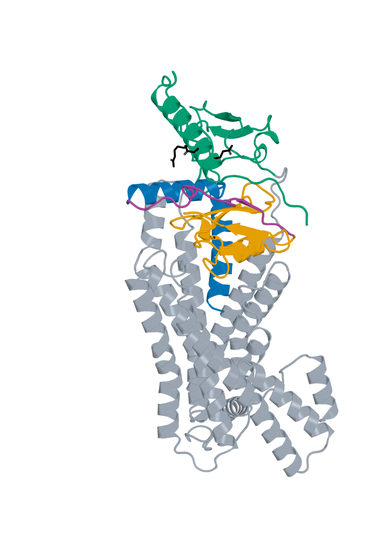

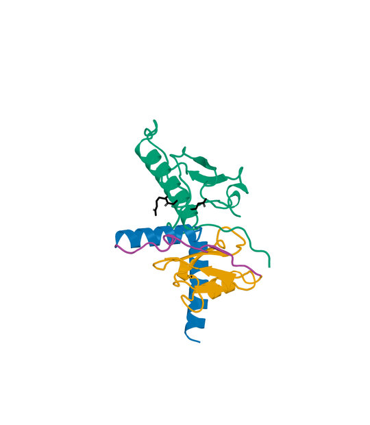

Figure 12. LK_P012_08, final rank 12: Boltz2 Exact native model 0, seed 101, candidate chain A with one 440-aa human GLP1R chain B. Left: receptor-complex view. Right: interface detail. LigandForge orange, generated linker purple and ECD binder blue. ECD A1-39  linker A40-60  LF A61-125. Black sticks mark receptor E34, Q37 and R40. Receptor ECD B1-105 (UniProt 24-128) is teal; remaining receptor is gray. The panels preserve their saved rigid receptor-core alignment and use different zooms. The detailed panel is a focused display and omits distal receptor context; all residues remain in the scored model.


## 5.13  LK_P062_00

Rank 13 | AP Novo linked fusion | 146 residues | Highest Exact ipSAE order retained

**Creation route.** AP Novo ECD generation and standalone Exact parent selection + original LigandForge generation and standalone Exact parent prediction -> recorded orientation and pair selection -> AP Novo linker generation -> complete fusion Exact refolding -> extracellular screen -> DeltaForge prediction.

### LK_P062_00: creation history

**ECD parent.** S10_04_045, suite apnovo_L40-60_linkerfixed, shard 4; 46 aa, standalone parent Exact rank 14.0, ipSAE 0.910705. The saved generator reference matches its component sequence. Its upstream R40 target context follows section 2.1.

**LigandForge parent.** Design_280, 69 aa, original standalone Exact rank 979.0, ipSAE 0.010649. Its original generated coordinates are unavailable. These parent scores describe standalone models, not the fused molecule.

**Exact fusion construction.** Pair P062; direction ECD->LF; AP Novo seed 721, native attempt 0. One-based inclusive boundaries: ECD A1-46; linker A47-77; LF A78-146. The 31-aa generated linker is `GGVGSGHPLEPITIVRPPPVPELEPITGPVT`; its allowed source range was 24-36 aa. Both parent sequences and the full linker are sequence-verified in the selected molecule; no unrecorded substitutions or terminal trimming were applied.

**Validation.** Complete fused chain A plus 440-aa receptor B, Exact seed 101, source native model 0. Post-refold free-C-terminal OPM z = 49.68 A; extracellular-margin check passed. This does not establish assay accessibility or activation.

**DeltaForge Kd:** 1.131358 nM, computational prediction for one full 146-aa candidate chain against one 440-aa GLP1R chain. Provider scope: long_gt_140; quotable prediction: True. The scorer and calibration are those in section 2.5.

**Exact selected sequence (N to C):**

```text
MTDIGEEIKALVALTEGVPPENRPFAVELAQRLSPWFSLYSRLSSRGGVGSGHPLEPITIVRPPPVPELE
PITGPVTEVSGATIDLRVKTCVDFKQTVNFFKLRNTQLPGSCTKDNTVLFLLEGLKLGYASRYFSIGSGS
GSQQFS
```


## 5.13  LK_P062_00 - validation and provenance

**Current review.** Exact-sequence and scoring-input checks passed. Functional activation and measured Kd remain unavailable.

| Source and molecular scope | Metric | Value |
| --- | --- | --- |
| Boltz2 Exact / human / seed101 / model0 / A-B | ipSAE Type=max (PAE10, dist15) | 0.900237 |
| same native model | ipTM | 0.878043 |
| same native model | directional ipSAE A->B / B->A | 0.900237 / 0.707902 |
| same native model | fusion pLDDT / linker pLDDT (0-100) | 55.87 / 49.45 |
| same native model | ECD / LigandForge segment pLDDT (0-100) | 61.51 / 55.00 |
| generator versus Exact | complete fusion DockQ (self-consistency) | 0.1047 |
| DeltaForge / intact monomer + receptor | predicted Kd (nM) | 1.131358 |
| within-population top50 | predicted-Kd rank (separate from Exact rank) | 10 |
| Boltz2 Exact | pDockQ / pDockQ2 / LIS | 0.2581 / 0.1250 / 0.6018 |
| AP Novo versus Exact | fusion TM-score / receptor-core RMSD A | 0.2653 / 1.8138 |
| Boltz2 Exact | E34 / Q37 / R40 minimum side-chain distance A | 7.73 / 6.24 / 4.19 |
| Boltz2 Exact | max peptide C-N bond A / out-of-range count | 1.335 / 0 |
| DeltaForge | contacts / H bonds / salt bridges / hydrophobic contacts | 83 / 6 / 5 / 17 |

**Interpretation.** Whole-fusion and segment pLDDT expose uncertainty beyond the interface score. The standalone parent interfaces and fusion placement can differ, and no experimental structure validates the predicted geometry.


**Computational provenance.** ECD parent: suite apnovo_L40-60_linkerfixed, shard 4, output 045, shard seed start 501. Linker-generation run 2026-10-24_pair185-apnovo-linkers_004; accepted run 2026-10-24_pair183-extracellular-generation_001; Exact run 2026-10-24_pair183-extracellular-exact_001; ranking run 2026-10-25_linker-top100-ranking_002. Junction gap 67.577 A; actual context radius 10.0 A; 259 receptor-context residues; maximum assembled input 410 residues. Context input chains: A = native B1-130, B = native B163-200, C = native B202-222, E = native B260-262, F = native B264-266, G = native B268-295, H = native B337-372. Exact AP Novo motif: D1-46,24-36,L1-69/A1-130/B1-38/C1-21/E1-3/F1-3/G1-28/H1-36. Fixed-domain C-alpha RMSD after generation: 0.000509 A.

**Scientific identities (SHA-256).**

```text
S10_04_045 parent Exact
42bee739ad3ea8889579aae7e3402f85e48d9e31a416426d73182ad7ff994fef
S10_04_045 parent AP Novo generator
1c9ba80c4095d0317b129f308959d64e96c9c7f5f8a767ffa10932c59762ac9b
Design_280 parent Exact
30aef35712822acd137e6b1a15aae02c4bace0383fe59446de7f5b8c27af09ff
AP Novo fixed-domain motif input
4027c5dda3765af7e954c782c458b10daa714c212e41186ca6bd09ce784a4ac2
AP Novo fusion generator
9008653a66ff8a572806a4085c29b01d5e0acabfbcff19fdb0d803955167fbff
Selected full sequence
d25de47402eaf8301bd45d56bf0ab83b327eb81914b61bab0977a3e01daa140d
Selected Boltz2 Exact model
dce45c8b68d53fc8283de14d7c4b58921b395dc5b766260bc32bf5e75240d8f3
DeltaForge scoring input
f7d9595940d943470113693a9381f7b685598b8ba2b8ab0f1feddd5d3092ab4e
```

## 5.13  LK_P062_00 - bound structures

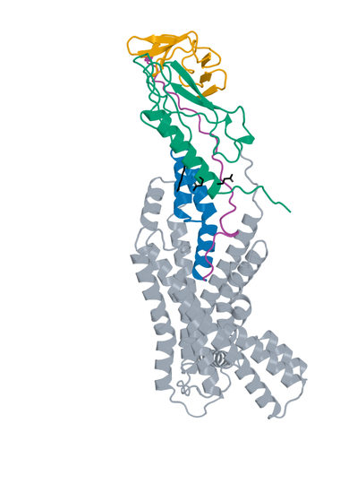

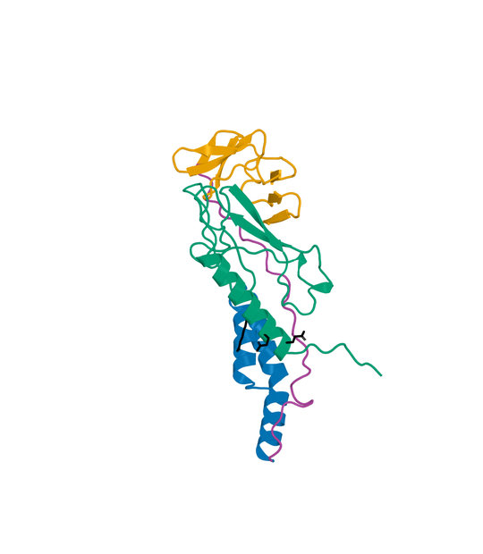

Figure 13. LK_P062_00, final rank 13: Boltz2 Exact native model 0, seed 101, candidate chain A with one 440-aa human GLP1R chain B. Left: receptor-complex view. Right: interface detail. LigandForge orange, generated linker purple and ECD binder blue. ECD A1-46  linker A47-77  LF A78-146. Black sticks mark receptor E34, Q37 and R40. Receptor ECD B1-105 (UniProt 24-128) is teal; remaining receptor is gray. The panels preserve their saved rigid receptor-core alignment and use different zooms. The detailed panel is a focused display and omits distal receptor context; all residues remain in the scored model.


## 5.14  Design_440

Rank 14 | original LigandForge | 54 residues | Highest Exact ipSAE order retained

**Creation route.** LigandForge Generation 1 -> exported full sequence with fixed GSGSGS and terminal four residues -> unconstrained 409-aa receptor Exact prediction -> saved DeltaForge prediction -> final filter and ranking.

### Design_440: creation history

**LigandForge generation.** Job 31e52bf6-d21e-448a-8633-da4073e20b3f, generator v6.5.21, provider export position 440. This position is distinct from original Exact rank 13. The complete assembled sequence is retained, including its GSGSGS suffix region and final four residues. The submitted-versus-featurized pocket uncertainty in section 2.1 applies. No generator coordinate comparison can be made.

**Exact sequence handoff.** The selected sequence matches the original exported record and completed original Exact population by SHA-256. No mutation, fusion, shortening, cyclization or imposed disulfide chemistry was added in this report.

**Validation.** Candidate chain A plus 409-aa receptor B, Exact seed 101, source native model 0; no hotspot constraints during complex prediction. The saved Exact model, scoring-PDB sequence and DeltaForge input identity reconcile.

**DeltaForge Kd:** 4.395521 nM, computational prediction for one full 54-aa candidate chain against one 409-aa GLP1R chain. Provider scope: core_40_119; quotable prediction: True. The scorer and calibration are those in section 2.5.

**Exact selected sequence (N to C):**

```text
PNYFGFTGFLCIVGDINIGRKAEEFQFFGAIKGGGIEFVCKSDVGSGSGSILFN
```


## 5.14  Design_440 - validation and provenance

**Current review.** Exact-sequence and scoring-input checks passed. Functional activation and measured Kd remain unavailable.

| Source and molecular scope | Metric | Value |
| --- | --- | --- |
| Boltz2 Exact / human / seed101 / model0 / A-B | ipSAE Type=max (PAE10, dist15) | 0.900081 |
| same native model | ipTM | 0.963251 |
| same native model | complex pLDDT (native fraction) | 0.789969 |
| generator versus Exact | structural self-consistency | Unavailable: generator coordinates absent |
| DeltaForge / intact monomer + receptor | predicted Kd (nM) | 4.395521 |
| within-population top50 | predicted-Kd rank (separate from Exact rank) | 19 |
| DeltaForge | contacts / H bonds / salt bridges / hydrophobic contacts | 95 / 9 / 5 / 21 |

**Interpretation.** Interface scores and estimated affinity prioritize this exact sequence. They do not resolve the original generation pocket discrepancy or establish receptor activation.


**Computational provenance.** Original LigandForge job 31e52bf6-d21e-448a-8633-da4073e20b3f; vendor output 440; retained provider created-at 2026-10-15T23:00:47.166Z. Exact run 2026-10-15_ligandforge-exact_001; source population rank 13. The full sequence is the generator output supplied to Exact, with no redesign. Original generator coordinates and the submitted receptor bytes are unavailable.

**Additional generator predictions.** Provider immunogenicity risk 0.141 (grade C); MHC-I / MHC-II risk 0.14 / 0.102; proteolytic grade D; cleavage-site density 0.5191; N-end-rule proxy 7200 min. These are provider predictions with no validation or uncertainty estimate in this study.

**Selected input identities (SHA-256).**

```text
Sequence
6c59785b808d0f88b202feec60fb02b1916c40b1d343c3525c2990c255ce2819
Boltz2 Exact native model
472cb2faf83cc57ac6a6924c72a44f06f02ec0d85e3226147c08b51bc594cb21
DeltaForge scoring input
700bc40ed25e70ba088da4728f31148ae15d80d859a0f2923c3252627429a0d6
```


## 5.14  Design_440 - bound structures

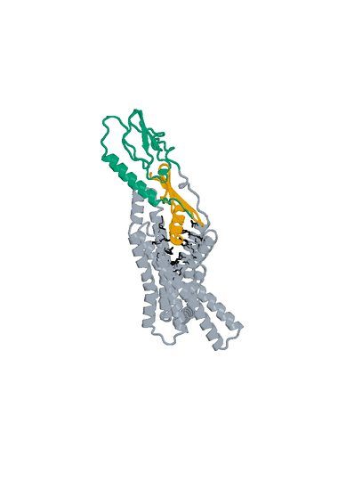

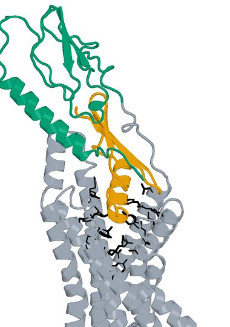

Figure 14. Design_440, final rank 14: Boltz2 Exact native model 0, seed 101, candidate chain A with one 409-aa human GLP1R chain B. Left: receptor-complex view. Right: interface detail. The complete 54-aa LigandForge chain A is orange. Black sticks mark the 27 submitted original pocket positions. Receptor ECD B1-105 (UniProt 24-128) is teal; remaining receptor is gray. The panels preserve their saved rigid receptor-core alignment and use different zooms. The detailed panel is a focused display and omits distal receptor context; all residues remain in the scored model.


## 5.15  LK_P141_07

Rank 15 | AP Novo linked fusion | 121 residues | Highest Exact ipSAE order retained

**Creation route.** AP Novo ECD generation and standalone Exact parent selection + original LigandForge generation and standalone Exact parent prediction -> recorded orientation and pair selection -> AP Novo linker generation -> complete fusion Exact refolding -> extracellular screen -> DeltaForge prediction.

### LK_P141_07: creation history

**ECD parent.** S09_03_086, suite apnovo_L20-40_linkerflex, shard 3; 32 aa, standalone parent Exact rank 97.0, ipSAE 0.891224. The saved generator reference matches its component sequence. Its upstream R40 target context follows section 2.1.

**LigandForge parent.** Design_280, 69 aa, original standalone Exact rank 979.0, ipSAE 0.010649. Its original generated coordinates are unavailable. These parent scores describe standalone models, not the fused molecule.

**Exact fusion construction.** Pair P141; direction ECD->LF; AP Novo seed 1518, native attempt 7. One-based inclusive boundaries: ECD A1-32; linker A33-52; LF A53-121. The 20-aa generated linker is `GSGLPPPPPPVDVIPPSEVK`; its allowed source range was 16-28 aa. Both parent sequences and the full linker are sequence-verified in the selected molecule; no unrecorded substitutions or terminal trimming were applied.

**Validation.** Complete fused chain A plus 440-aa receptor B, Exact seed 101, source native model 0. Post-refold free-C-terminal OPM z = 76.38 A; extracellular-margin check passed. This does not establish assay accessibility or activation.

**DeltaForge Kd:** 1.626960 nM, computational prediction for one full 121-aa candidate chain against one 440-aa GLP1R chain. Provider scope: platform_8_140; quotable prediction: True. The scorer and calibration are those in section 2.5.

**Exact selected sequence (N to C):**

```text
MVSIGSTGFDGLLQLDEELRNLFLQRLVLGRLGSGLPPPPPPVDVIPPSEVKEVSGATIDLRVKTCVDFK
QTVNFFKLRNTQLPGSCTKDNTVLFLLEGLKLGYASRYFSIGSGSGSQQFS
```


## 5.15  LK_P141_07 - validation and provenance

**Current review.** Exact-sequence and scoring-input checks passed. Functional activation and measured Kd remain unavailable.

| Source and molecular scope | Metric | Value |
| --- | --- | --- |
| Boltz2 Exact / human / seed101 / model0 / A-B | ipSAE Type=max (PAE10, dist15) | 0.899774 |
| same native model | ipTM | 0.883820 |
| same native model | directional ipSAE A->B / B->A | 0.899774 / 0.483125 |
| same native model | fusion pLDDT / linker pLDDT (0-100) | 59.92 / 61.74 |
| same native model | ECD / LigandForge segment pLDDT (0-100) | 71.35 / 54.10 |
| generator versus Exact | complete fusion DockQ (self-consistency) | 0.2736 |
| DeltaForge / intact monomer + receptor | predicted Kd (nM) | 1.626960 |
| within-population top50 | predicted-Kd rank (separate from Exact rank) | 17 |
| Boltz2 Exact | pDockQ / pDockQ2 / LIS | 0.4125 / 0.2650 / 0.4689 |
| AP Novo versus Exact | fusion TM-score / receptor-core RMSD A | 0.3009 / 0.6195 |
| Boltz2 Exact | E34 / Q37 / R40 minimum side-chain distance A | 7.43 / 10.70 / 8.77 |
| Boltz2 Exact | max peptide C-N bond A / out-of-range count | 1.340 / 0 |
| DeltaForge | contacts / H bonds / salt bridges / hydrophobic contacts | 62 / 7 / 5 / 18 |

**Interpretation.** Whole-fusion and segment pLDDT expose uncertainty beyond the interface score. The standalone parent interfaces and fusion placement can differ, and no experimental structure validates the predicted geometry.


**Computational provenance.** ECD parent: suite apnovo_L20-40_linkerflex, shard 3, output 086, shard seed start 401. Linker-generation run 2026-10-24_pair185-apnovo-linkers_004; accepted run 2026-10-24_pair183-extracellular-generation_001; Exact run 2026-10-24_pair183-extracellular-exact_001; ranking run 2026-10-25_linker-top100-ranking_002. Junction gap 44.972 A; actual context radius 10.0 A; 263 receptor-context residues; maximum assembled input 392 residues. Context input chains: A = native B1-130, B = native B165-222, C = native B256-262, E = native B264-266, F = native B268-296, G = native B337-372. Exact AP Novo motif: D1-32,16-28,L1-69/A1-130/B1-58/C1-7/E1-3/F1-29/G1-36. Fixed-domain C-alpha RMSD after generation: 0.000493 A.

**Scientific identities (SHA-256).**

```text
S09_03_086 parent Exact
26c8b283d7625b48183462f5bd5690a221e91ad2f81f461de17fe46473dc3eee
S09_03_086 parent AP Novo generator
fa72db1f331d09537cffce2001bb412196ffc642e8cfd2c680f2170b91397a59
Design_280 parent Exact
30aef35712822acd137e6b1a15aae02c4bace0383fe59446de7f5b8c27af09ff
AP Novo fixed-domain motif input
d55d1ee8fd679a08704d9ee1c40326ed4ac8819b89c3f997e1039a22f4fcf498
AP Novo fusion generator
e480d8f90bf00852edb33cc0c93f84ee8119134b8edecda3198999e50e1ecb86
Selected full sequence
f16d400b253e38395bd82e22ebc6e5de8863a953f494c6219be2e224ae30c46c
Selected Boltz2 Exact model
057c941f900347a58c03754e4ed3405a7187730b30c880c5e8fa4ca13920b391
DeltaForge scoring input
6cd56c4f82f7f8db0c47931f50c2f85bc7cd0fe1513fb44df4ca27ff60f0de02
```

## 5.15  LK_P141_07 - bound structures

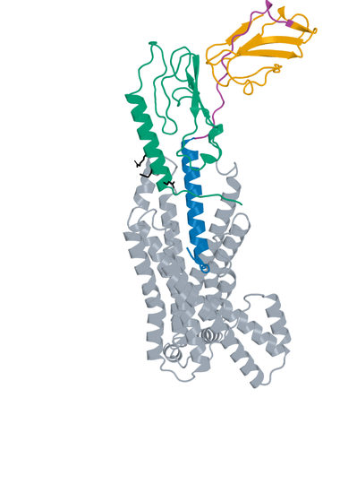

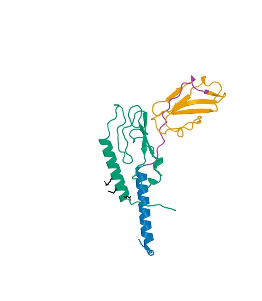

Figure 15. LK_P141_07, final rank 15: Boltz2 Exact native model 0, seed 101, candidate chain A with one 440-aa human GLP1R chain B. Left: receptor-complex view. Right: interface detail. LigandForge orange, generated linker purple and ECD binder blue. ECD A1-32  linker A33-52  LF A53-121. Black sticks mark receptor E34, Q37 and R40. Receptor ECD B1-105 (UniProt 24-128) is teal; remaining receptor is gray. The panels preserve their saved rigid receptor-core alignment and use different zooms. The detailed panel is a focused display and omits distal receptor context; all residues remain in the scored model.


## 5.16  LK_P002_05

Rank 16 | AP Novo linked fusion | 104 residues | Highest Exact ipSAE order retained

**Creation route.** AP Novo ECD generation and standalone Exact parent selection + original LigandForge generation and standalone Exact parent prediction -> recorded orientation and pair selection -> AP Novo linker generation -> complete fusion Exact refolding -> extracellular screen -> DeltaForge prediction.

### LK_P002_05: creation history

**ECD parent.** S10_03_014, suite apnovo_L40-60_linkerfixed, shard 3; 47 aa, standalone parent Exact rank 6.0, ipSAE 0.920382. The saved generator reference matches its component sequence. Its upstream R40 target context follows section 2.1.

**LigandForge parent.** Design_913, 36 aa, original standalone Exact rank 859.0, ipSAE 0.421797. Its original generated coordinates are unavailable. These parent scores describe standalone models, not the fused molecule.

**Exact fusion construction.** Pair P002; direction LF->ECD; AP Novo seed 126, native attempt 5. One-based inclusive boundaries: LF A1-36; linker A37-57; ECD A58-104. The 21-aa generated linker is `GKTSTSGPQPVIILPVPVLPG`; its allowed source range was 18-30 aa. Both parent sequences and the full linker are sequence-verified in the selected molecule; no unrecorded substitutions or terminal trimming were applied.

**Validation.** Complete fused chain A plus 440-aa receptor B, Exact seed 101, source native model 0. Post-refold free-C-terminal OPM z = 42.07 A; extracellular-margin check passed. This does not establish assay accessibility or activation.

**DeltaForge Kd:** 0.812989 nM, computational prediction for one full 104-aa candidate chain against one 440-aa GLP1R chain. Provider scope: core_40_119; quotable prediction: True. The scorer and calibration are those in section 2.5.

**Exact selected sequence (N to C):**

```text
NLPRIECSSNKGNVQEDSDVIGGRGSGSGSGSCGIFGKTSTSGPQPVIILPVPVLPGMLPQLFLTHMLSV
MVGTGSLDSGLVSAFRGSPLVSEAILGFLKQYLS
```


## 5.16  LK_P002_05 - validation and provenance

**Current review.** Exact-sequence and scoring-input checks passed. Functional activation and measured Kd remain unavailable.

| Source and molecular scope | Metric | Value |
| --- | --- | --- |
| Boltz2 Exact / human / seed101 / model0 / A-B | ipSAE Type=max (PAE10, dist15) | 0.899462 |
| same native model | ipTM | 0.936997 |
| same native model | directional ipSAE A->B / B->A | 0.899462 / 0.779243 |
| same native model | fusion pLDDT / linker pLDDT (0-100) | 43.81 / 38.20 |
| same native model | ECD / LigandForge segment pLDDT (0-100) | 51.46 / 37.09 |
| generator versus Exact | complete fusion DockQ (self-consistency) | 0.0893 |
| DeltaForge / intact monomer + receptor | predicted Kd (nM) | 0.812989 |
| within-population top50 | predicted-Kd rank (separate from Exact rank) | 4 |
| Boltz2 Exact | pDockQ / pDockQ2 / LIS | 0.1832 / 0.1014 / 0.6165 |
| AP Novo versus Exact | fusion TM-score / receptor-core RMSD A | 0.4190 / 0.8910 |
| Boltz2 Exact | E34 / Q37 / R40 minimum side-chain distance A | 8.23 / 5.63 / 2.74 |
| Boltz2 Exact | max peptide C-N bond A / out-of-range count | 1.330 / 0 |
| DeltaForge | contacts / H bonds / salt bridges / hydrophobic contacts | 97 / 5 / 0 / 19 |

**Interpretation.** Whole-fusion and segment pLDDT expose uncertainty beyond the interface score. The standalone parent interfaces and fusion placement can differ, and no experimental structure validates the predicted geometry.


**Computational provenance.** ECD parent: suite apnovo_L40-60_linkerfixed, shard 3, output 014, shard seed start 401. Linker-generation run 2026-10-24_pair185-apnovo-linkers_004; accepted run 2026-10-24_pair183-extracellular-generation_001; Exact run 2026-10-24_pair183-extracellular-exact_001; ranking run 2026-10-25_linker-top100-ranking_002. Junction gap 52.157 A; actual context radius 10.0 A; 371 receptor-context residues; maximum assembled input 484 residues. Context input chains: A = native B1-130, B = native B142-248, C = native B256-262, E = native B264-266, F = native B268-296, G = native B299-393. Exact AP Novo motif: L1-36,18-30,D1-47/A1-130/B1-107/C1-7/E1-3/F1-29/G1-95. Fixed-domain C-alpha RMSD after generation: 0.000514 A.

**Scientific identities (SHA-256).**

```text
S10_03_014 parent Exact
cdd875ebd00f3b4f2de3812e82ec59b8b668101edc71ff2a7b2b613085832ab0
S10_03_014 parent AP Novo generator
87247a04cd6370c6c108d675b046a8320581f4cf8bf111d5b3ce57d7964e6c3a
Design_913 parent Exact
b2373990b3aebe7845a666e9a9c0352ecdbfc828356d130267b3301f775b259e
AP Novo fixed-domain motif input
6d5da98519c1093c5294d88a6b9acddd45980ade2d4f0b3cc6aa224e9319f45c
AP Novo fusion generator
e930216edc30c3bf609478444adc5484e220f5107d789634200a81f1d37b9191
Selected full sequence
8dcbb7d8cdc0f0dedcabe96c99dedf901c32eddadf2c8d7dec2e96f528f8b01a
Selected Boltz2 Exact model
b42fd0d87e7deba61c440007ffdbe63e077f7982ac2d552a73dd74fd7a92bd52
DeltaForge scoring input
2cdbeaadafb5b0d2c96000faac08312915566af30e7bc4b1c57d5ce84f861e5d
```

## 5.16  LK_P002_05 - bound structures

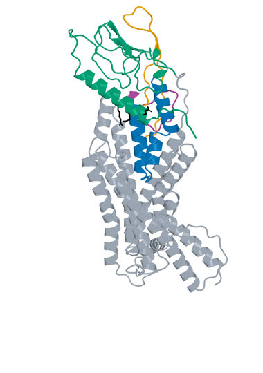

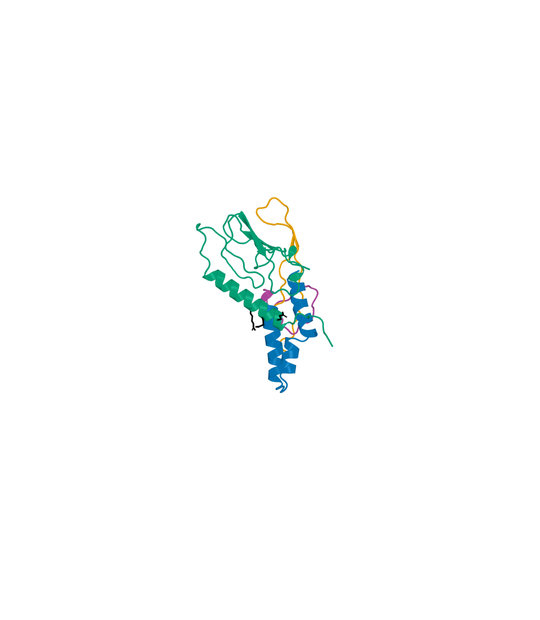

Figure 16. LK_P002_05, final rank 16: Boltz2 Exact native model 0, seed 101, candidate chain A with one 440-aa human GLP1R chain B. Left: receptor-complex view. Right: interface detail. LigandForge orange, generated linker purple and ECD binder blue. LF A1-36  linker A37-57  ECD A58-104. Black sticks mark receptor E34, Q37 and R40. Receptor ECD B1-105 (UniProt 24-128) is teal; remaining receptor is gray. The panels preserve their saved rigid receptor-core alignment and use different zooms. The detailed panel is a focused display and omits distal receptor context; all residues remain in the scored model.


## 5.17  LK_P012_04

Rank 17 | AP Novo linked fusion | 130 residues | Highest Exact ipSAE order retained

**Creation route.** AP Novo ECD generation and standalone Exact parent selection + original LigandForge generation and standalone Exact parent prediction -> recorded orientation and pair selection -> AP Novo linker generation -> complete fusion Exact refolding -> extracellular screen -> DeltaForge prediction.

### LK_P012_04: creation history

**ECD parent.** S08_00_042, suite apnovo_L20-40_linkerfixed, shard 0; 39 aa, standalone parent Exact rank 40.0, ipSAE 0.902628. The saved generator reference matches its component sequence. Its upstream R40 target context follows section 2.1.

**LigandForge parent.** Design_991, 65 aa, original standalone Exact rank 947.0, ipSAE 0.073587. Its original generated coordinates are unavailable. These parent scores describe standalone models, not the fused molecule.

**Exact fusion construction.** Pair P012; direction ECD->LF; AP Novo seed 225, native attempt 4. One-based inclusive boundaries: ECD A1-39; linker A40-65; LF A66-130. The 26-aa generated linker is `PGSSLLPLPEDTSDVASGSISYPGAS`; its allowed source range was 15-27 aa. Both parent sequences and the full linker are sequence-verified in the selected molecule; no unrecorded substitutions or terminal trimming were applied.

**Validation.** Complete fused chain A plus 440-aa receptor B, Exact seed 101, source native model 0. Post-refold free-C-terminal OPM z = 33.84 A; extracellular-margin check passed. This does not establish assay accessibility or activation.

**DeltaForge Kd:** 2.152798 nM, computational prediction for one full 130-aa candidate chain against one 440-aa GLP1R chain. Provider scope: platform_8_140; quotable prediction: True. The scorer and calibration are those in section 2.5.

**Exact selected sequence (N to C):**

```text
MADSISEVSEGVHLILAAQALELPPFVVAARLEEARAKRPGSSLLPLPEDTSDVASGSISYPGASAFHLT
GLAARCGAVWRGVFCQFGNGVKGEGSVTGGSLNTFYILTVAPTSANILTSGSGSGSLEGS
```


## 5.17  LK_P012_04 - validation and provenance

**Current review.** Exact-sequence and scoring-input checks passed. Functional activation and measured Kd remain unavailable.

| Source and molecular scope | Metric | Value |
| --- | --- | --- |
| Boltz2 Exact / human / seed101 / model0 / A-B | ipSAE Type=max (PAE10, dist15) | 0.899333 |
| same native model | ipTM | 0.885088 |
| same native model | directional ipSAE A->B / B->A | 0.899333 / 0.648700 |
| same native model | fusion pLDDT / linker pLDDT (0-100) | 46.21 / 36.02 |
| same native model | ECD / LigandForge segment pLDDT (0-100) | 70.56 / 35.67 |
| generator versus Exact | complete fusion DockQ (self-consistency) | 0.2180 |
| DeltaForge / intact monomer + receptor | predicted Kd (nM) | 2.152798 |
| within-population top50 | predicted-Kd rank (separate from Exact rank) | 22 |
| Boltz2 Exact | pDockQ / pDockQ2 / LIS | 0.2455 / 0.1128 / 0.5244 |
| AP Novo versus Exact | fusion TM-score / receptor-core RMSD A | 0.3621 / 0.8421 |
| Boltz2 Exact | E34 / Q37 / R40 minimum side-chain distance A | 7.08 / 3.12 / 2.85 |
| Boltz2 Exact | max peptide C-N bond A / out-of-range count | 1.333 / 0 |
| DeltaForge | contacts / H bonds / salt bridges / hydrophobic contacts | 98 / 18 / 9 / 27 |

**Interpretation.** Whole-fusion and segment pLDDT expose uncertainty beyond the interface score. The standalone parent interfaces and fusion placement can differ, and no experimental structure validates the predicted geometry.


**Computational provenance.** ECD parent: suite apnovo_L20-40_linkerfixed, shard 0, output 042, shard seed start 101. Linker-generation run 2026-10-24_pair185-apnovo-linkers_004; accepted run 2026-10-24_pair183-extracellular-generation_001; Exact run 2026-10-24_pair183-extracellular-exact_001; ranking run 2026-10-25_linker-top100-ranking_002. Junction gap 42.926 A; actual context radius 10.0 A; 258 receptor-context residues; maximum assembled input 389 residues. Context input chains: A = native B1-106, B = native B109-130, C = native B163-219, E = native B256-262, F = native B264-295, G = native B339-372. Exact AP Novo motif: D1-39,15-27,L1-65/A1-106/B1-22/C1-57/E1-7/F1-32/G1-34. Fixed-domain C-alpha RMSD after generation: 0.000488 A.

**Scientific identities (SHA-256).**

```text
S08_00_042 parent Exact
47158f64559e10c04f5ba9c937402e611695936805e4651d8419682b213f104f
S08_00_042 parent AP Novo generator
7b512af1937e4c7e65c796c47d3fe7f2c3a07fb057b645eefb6655bf46811c6b
Design_991 parent Exact
d8fee8dc32b9fc9e6718f04438f90db1ff271c9e01c8210a1d31944ac9918613
AP Novo fixed-domain motif input
cdda3d678589e1207bf352af647f8865139e26bb48ef60c4b17559fd3bc4a4e3
AP Novo fusion generator
c2dc301b899bfad71bcee91b9f020260d960fd3806f48ac8962060706dccb3c0
Selected full sequence
dbbc237dccc285527f5d99d62ad5158c233c2b751f987bc25776a166dbf16745
Selected Boltz2 Exact model
1d47cee516c18104b88f5b283af8be679b4a8c5f2c472cbd34a48b119664eacf
DeltaForge scoring input
fa1a5cc220f038b3a600579b7d83ec75b07b002432a35db4fdb020eb8d503754
```

## 5.17  LK_P012_04 - bound structures

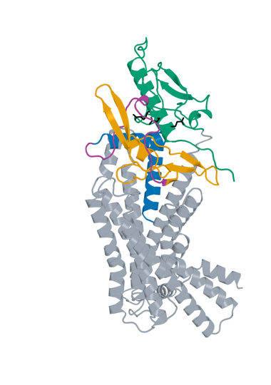

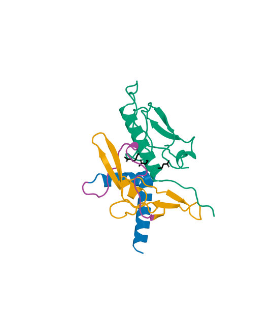

Figure 17. LK_P012_04, final rank 17: Boltz2 Exact native model 0, seed 101, candidate chain A with one 440-aa human GLP1R chain B. Left: receptor-complex view. Right: interface detail. LigandForge orange, generated linker purple and ECD binder blue. ECD A1-39  linker A40-65  LF A66-130. Black sticks mark receptor E34, Q37 and R40. Receptor ECD B1-105 (UniProt 24-128) is teal; remaining receptor is gray. The panels preserve their saved rigid receptor-core alignment and use different zooms. The detailed panel is a focused display and omits distal receptor context; all residues remain in the scored model.


## 5.18  Design_787

Rank 18 | original LigandForge | 49 residues | Highest Exact ipSAE order retained

**Creation route.** LigandForge Generation 1 -> exported full sequence with fixed GSGSGS and terminal four residues -> unconstrained 409-aa receptor Exact prediction -> saved DeltaForge prediction -> final filter and ranking.

### Design_787: creation history

**LigandForge generation.** Job 31e52bf6-d21e-448a-8633-da4073e20b3f, generator v6.5.21, provider export position 787. This position is distinct from original Exact rank 14. The complete assembled sequence is retained, including its GSGSGS suffix region and final four residues. The submitted-versus-featurized pocket uncertainty in section 2.1 applies. No generator coordinate comparison can be made.

**Exact sequence handoff.** The selected sequence matches the original exported record and completed original Exact population by SHA-256. No mutation, fusion, shortening, cyclization or imposed disulfide chemistry was added in this report.

**Validation.** Candidate chain A plus 409-aa receptor B, Exact seed 101, source native model 0; no hotspot constraints during complex prediction. The saved Exact model, scoring-PDB sequence and DeltaForge input identity reconcile.

**DeltaForge Kd:** 5.382388 nM, computational prediction for one full 49-aa candidate chain against one 409-aa GLP1R chain. Provider scope: core_40_119; quotable prediction: True. The scorer and calibration are those in section 2.5.

**Exact selected sequence (N to C):**

```text
GTLALTHCVFAADRAEIFGQRGKEDLQTGKAASEGTELTGSGSGSLCDI
```


## 5.18  Design_787 - validation and provenance

**Current review.** Exact-sequence and scoring-input checks passed. Functional activation and measured Kd remain unavailable.

| Source and molecular scope | Metric | Value |
| --- | --- | --- |
| Boltz2 Exact / human / seed101 / model0 / A-B | ipSAE Type=max (PAE10, dist15) | 0.899274 |
| same native model | ipTM | 0.954639 |
| same native model | complex pLDDT (native fraction) | 0.786404 |
| generator versus Exact | structural self-consistency | Unavailable: generator coordinates absent |
| DeltaForge / intact monomer + receptor | predicted Kd (nM) | 5.382388 |
| within-population top50 | predicted-Kd rank (separate from Exact rank) | 20 |
| DeltaForge | contacts / H bonds / salt bridges / hydrophobic contacts | 100 / 7 / 6 / 20 |

**Interpretation.** Interface scores and estimated affinity prioritize this exact sequence. They do not resolve the original generation pocket discrepancy or establish receptor activation.


**Computational provenance.** Original LigandForge job 31e52bf6-d21e-448a-8633-da4073e20b3f; vendor output 787; retained provider created-at 2026-10-15T23:00:47.909Z. Exact run 2026-10-15_ligandforge-exact_001; source population rank 14. The full sequence is the generator output supplied to Exact, with no redesign. Original generator coordinates and the submitted receptor bytes are unavailable.

**Additional generator predictions.** Provider immunogenicity risk 0.061 (grade B); MHC-I / MHC-II risk 0.037 / 0.076; proteolytic grade C; cleavage-site density 0.4781; N-end-rule proxy 1800 min. These are provider predictions with no validation or uncertainty estimate in this study.

**Selected input identities (SHA-256).**

```text
Sequence
e11fb509424a5ca3dd92ee2cacc0e8ae58c837c5042c87262252daca0a0735e6
Boltz2 Exact native model
816d2168df76e72a1b6331b8b6977e40dd10424e3a8b21e45874bfac455c907e
DeltaForge scoring input
18a8ac6f85f1f1a8b05eb12e1356eed1050e50ec10b8a5d10afb50b4c04c0b3d
```


## 5.18  Design_787 - bound structures

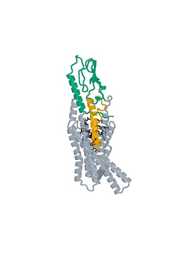

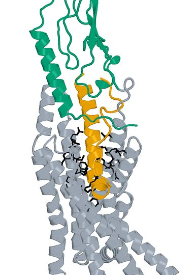

Figure 18. Design_787, final rank 18: Boltz2 Exact native model 0, seed 101, candidate chain A with one 409-aa human GLP1R chain B. Left: receptor-complex view. Right: interface detail. The complete 49-aa LigandForge chain A is orange. Black sticks mark the 27 submitted original pocket positions. Receptor ECD B1-105 (UniProt 24-128) is teal; remaining receptor is gray. The panels preserve their saved rigid receptor-core alignment and use different zooms. The detailed panel is a focused display and omits distal receptor context; all residues remain in the scored model.


## 5.19  Design_15

Rank 19 | original LigandForge | 50 residues | Highest Exact ipSAE order retained

**Creation route.** LigandForge Generation 1 -> exported full sequence with fixed GSGSGS and terminal four residues -> unconstrained 409-aa receptor Exact prediction -> saved DeltaForge prediction -> final filter and ranking.

### Design_15: creation history

**LigandForge generation.** Job 31e52bf6-d21e-448a-8633-da4073e20b3f, generator v6.5.21, provider export position 15. This position is distinct from original Exact rank 15. The complete assembled sequence is retained, including its GSGSGS suffix region and final four residues. The submitted-versus-featurized pocket uncertainty in section 2.1 applies. No generator coordinate comparison can be made.

**Exact sequence handoff.** The selected sequence matches the original exported record and completed original Exact population by SHA-256. No mutation, fusion, shortening, cyclization or imposed disulfide chemistry was added in this report.

**Validation.** Candidate chain A plus 409-aa receptor B, Exact seed 101, source native model 0; no hotspot constraints during complex prediction. The saved Exact model, scoring-PDB sequence and DeltaForge input identity reconcile.

**DeltaForge Kd:** 4.290674 nM, computational prediction for one full 50-aa candidate chain against one 409-aa GLP1R chain. Provider scope: core_40_119; quotable prediction: True. The scorer and calibration are those in section 2.5.

**Exact selected sequence (N to C):**

```text
AQCTKTYAIGYDVYLKLTYLGFRRADGAGNDDDVCAGNVGGSGSGSFFVA
```


## 5.19  Design_15 - validation and provenance

**Current review.** Exact-sequence and scoring-input checks passed. Functional activation and measured Kd remain unavailable.

| Source and molecular scope | Metric | Value |
| --- | --- | --- |
| Boltz2 Exact / human / seed101 / model0 / A-B | ipSAE Type=max (PAE10, dist15) | 0.898565 |
| same native model | ipTM | 0.947101 |
| same native model | complex pLDDT (native fraction) | 0.694463 |
| generator versus Exact | structural self-consistency | Unavailable: generator coordinates absent |
| DeltaForge / intact monomer + receptor | predicted Kd (nM) | 4.290674 |
| within-population top50 | predicted-Kd rank (separate from Exact rank) | 18 |
| DeltaForge | contacts / H bonds / salt bridges / hydrophobic contacts | 74 / 8 / 4 / 17 |

**Interpretation.** Interface scores and estimated affinity prioritize this exact sequence. They do not resolve the original generation pocket discrepancy or establish receptor activation.


**Computational provenance.** Original LigandForge job 31e52bf6-d21e-448a-8633-da4073e20b3f; vendor output 15; retained provider created-at 2026-10-15T23:00:46.439Z. Exact run 2026-10-15_ligandforge-exact_001; source population rank 15. The full sequence is the generator output supplied to Exact, with no redesign. Original generator coordinates and the submitted receptor bytes are unavailable.

**Additional generator predictions.** Provider immunogenicity risk 0.122 (grade C); MHC-I / MHC-II risk 0.102 / 0.112; proteolytic grade D; cleavage-site density 0.5501; N-end-rule proxy 4200 min. These are provider predictions with no validation or uncertainty estimate in this study.

**Selected input identities (SHA-256).**

```text
Sequence
e7fac62187212f65b2a764763628350b1c757d258eb4147ac26ba5021bebe78e
Boltz2 Exact native model
bcd1d04d8dee32c20c86771c363c15c14fdc4fb96e6e093c512124f54408a169
DeltaForge scoring input
71fa77b7cdcd0a9762fb5d17a3502ae4c828c88fdf0e39cb6050f417908e3409
```


## 5.19  Design_15 - bound structures

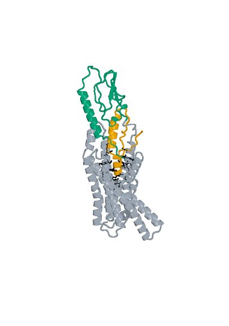

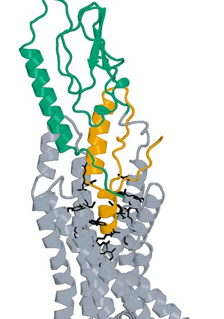

Figure 19. Design_15, final rank 19: Boltz2 Exact native model 0, seed 101, candidate chain A with one 409-aa human GLP1R chain B. Left: receptor-complex view. Right: interface detail. The complete 50-aa LigandForge chain A is orange. Black sticks mark the 27 submitted original pocket positions. Receptor ECD B1-105 (UniProt 24-128) is teal; remaining receptor is gray. The panels preserve their saved rigid receptor-core alignment and use different zooms. The detailed panel is a focused display and omits distal receptor context; all residues remain in the scored model.


## 5.20  LK_P093_03

Rank 20 | AP Novo linked fusion | 159 residues | Highest Exact ipSAE order retained

**Creation route.** AP Novo ECD generation and standalone Exact parent selection + original LigandForge generation and standalone Exact parent prediction -> recorded orientation and pair selection -> AP Novo linker generation -> complete fusion Exact refolding -> extracellular screen -> DeltaForge prediction.

### LK_P093_03: creation history

**ECD parent.** S10_02_067, suite apnovo_L40-60_linkerfixed, shard 2; 60 aa, standalone parent Exact rank 48.0, ipSAE 0.900299. The saved generator reference matches its component sequence. Its upstream R40 target context follows section 2.1.

**LigandForge parent.** Design_280, 69 aa, original standalone Exact rank 979.0, ipSAE 0.010649. Its original generated coordinates are unavailable. These parent scores describe standalone models, not the fused molecule.

**Exact fusion construction.** Pair P093; direction ECD->LF; AP Novo seed 1034, native attempt 3. One-based inclusive boundaries: ECD A1-60; linker A61-90; LF A91-159. The 30-aa generated linker is `GISSSVPDPRTPPPPPPPVPVEPLDPSSLT`; its allowed source range was 23-35 aa. Both parent sequences and the full linker are sequence-verified in the selected molecule; no unrecorded substitutions or terminal trimming were applied.

**Validation.** Complete fused chain A plus 440-aa receptor B, Exact seed 101, source native model 0. Post-refold free-C-terminal OPM z = 63.98 A; extracellular-margin check passed. This does not establish assay accessibility or activation.

**DeltaForge Kd:** 0.823155 nM, computational prediction for one full 159-aa candidate chain against one 440-aa GLP1R chain. Provider scope: long_gt_140; quotable prediction: True. The scorer and calibration are those in section 2.5.

**Exact selected sequence (N to C):**

```text
SSSSSVPAPSIDYLGAFREHGANAEVAEFLYRYLREIKGKSEKEAILLLTAAASIANLVAGISSSVPDPR
TPPPPPPPVPVEPLDPSSLTEVSGATIDLRVKTCVDFKQTVNFFKLRNTQLPGSCTKDNTVLFLLEGLKL
GYASRYFSIGSGSGSQQFS
```


## 5.20  LK_P093_03 - validation and provenance

**Current review.** Exact-sequence and scoring-input checks passed. Functional activation and measured Kd remain unavailable.

| Source and molecular scope | Metric | Value |
| --- | --- | --- |
| Boltz2 Exact / human / seed101 / model0 / A-B | ipSAE Type=max (PAE10, dist15) | 0.898297 |
| same native model | ipTM | 0.886405 |
| same native model | directional ipSAE A->B / B->A | 0.898297 / 0.587647 |
| same native model | fusion pLDDT / linker pLDDT (0-100) | 52.43 / 42.33 |
| same native model | ECD / LigandForge segment pLDDT (0-100) | 68.24 / 43.06 |
| generator versus Exact | complete fusion DockQ (self-consistency) | 0.2733 |
| DeltaForge / intact monomer + receptor | predicted Kd (nM) | 0.823155 |
| within-population top50 | predicted-Kd rank (separate from Exact rank) | 5 |
| Boltz2 Exact | pDockQ / pDockQ2 / LIS | 0.4014 / 0.1735 / 0.5061 |
| AP Novo versus Exact | fusion TM-score / receptor-core RMSD A | 0.4004 / 0.8350 |
| Boltz2 Exact | E34 / Q37 / R40 minimum side-chain distance A | 3.24 / 2.87 / 2.69 |
| Boltz2 Exact | max peptide C-N bond A / out-of-range count | 1.336 / 0 |
| DeltaForge | contacts / H bonds / salt bridges / hydrophobic contacts | 111 / 9 / 7 / 34 |

**Interpretation.** Whole-fusion and segment pLDDT expose uncertainty beyond the interface score. The standalone parent interfaces and fusion placement can differ, and no experimental structure validates the predicted geometry.


**Computational provenance.** ECD parent: suite apnovo_L40-60_linkerfixed, shard 2, output 067, shard seed start 301. Linker-generation run 2026-10-24_pair185-apnovo-linkers_004; accepted run 2026-10-24_pair183-extracellular-generation_001; Exact run 2026-10-24_pair183-extracellular-exact_001; ranking run 2026-10-25_linker-top100-ranking_002. Junction gap 65.161 A; actual context radius 10.0 A; 243 receptor-context residues; maximum assembled input 407 residues. Context input chains: A = native B1-130, B = native B166-200, C = native B202-215, E = native B217-219, F = native B260-262, G = native B264-266, H = native B268-291, I = native B340-370. Exact AP Novo motif: D1-60,23-35,L1-69/A1-130/B1-35/C1-14/E1-3/F1-3/G1-3/H1-24/I1-31. Fixed-domain C-alpha RMSD after generation: 0.000491 A.

**Scientific identities (SHA-256).**

```text
S10_02_067 parent Exact
b2ebc02f7e6660e37faffbca337aaea30b0f0fa76b75ca6abebefe1a58905375
S10_02_067 parent AP Novo generator
8e0d4f9dec5f4436c6ac152c39bf6faaf3266c7e62f8d4920664e7108a87a597
Design_280 parent Exact
30aef35712822acd137e6b1a15aae02c4bace0383fe59446de7f5b8c27af09ff
AP Novo fixed-domain motif input
f657b27a787250831613ffa366508ca07a30feeae2a3b2bd941b69d1032ad33a
AP Novo fusion generator
13af23cdf6fca1be5ad50d0d55042a351a50da601c9fdd5c93b7622a06a8096f
Selected full sequence
ddaad34132315edb9525884bb57cf70c07f16c0b611a51a9dea9902ffba6d6e1
Selected Boltz2 Exact model
ff5831a2a7632820d3e465ce3445e724379a6db0ce217efbba99701e140f8de9
DeltaForge scoring input
12df24d378b79870f19f5a6a3bb38a43b4e53f9fd9673d39f9430e91854160c5
```

## 5.20  LK_P093_03 - bound structures

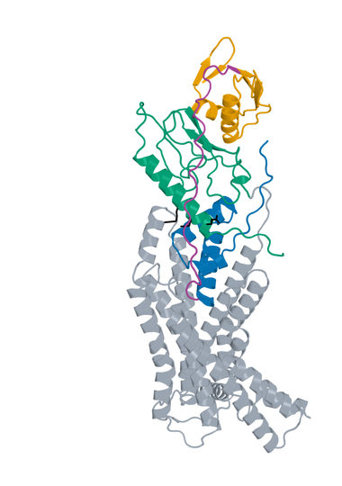

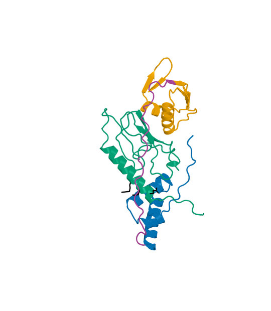

Figure 20. LK_P093_03, final rank 20: Boltz2 Exact native model 0, seed 101, candidate chain A with one 440-aa human GLP1R chain B. Left: receptor-complex view. Right: interface detail. LigandForge orange, generated linker purple and ECD binder blue. ECD A1-60  linker A61-90  LF A91-159. Black sticks mark receptor E34, Q37 and R40. Receptor ECD B1-105 (UniProt 24-128) is teal; remaining receptor is gray. The panels preserve their saved rigid receptor-core alignment and use different zooms. The detailed panel is a focused display and omits distal receptor context; all residues remain in the scored model.


## 6  Interpreting the computational evidence

This set is a ranked computational proposal for synthesis and testing. High Exact ipSAE does not guarantee binding; low predicted Kd does not establish experimental affinity; neither proves agonism. The 409-aa versus 440-aa receptor distinction, unresolved original generation pocket mapping, modest confidence in some fusion segments and missing original generator coordinates constrain interpretation. No experimental EC50, Emax, binding Kd, selectivity, expression or stability result is available for these candidates.

Standalone parent performance and fused performance remain separate. The model identities connect each sequence to its saved Exact prediction and the precise structural input scored for affinity. Historical source fingerprints identify recorded implementations without certifying provider model performance or reproducing every historical runtime.

The five additional threshold-passing candidates excluded by the final-rank cutoff were:

| Design | Exact ipSAE | Predicted Kd nM |
| --- | --- | --- |
| LK_P124_07 | 0.898224 | 0.755691 |
| LK_P096_01 | 0.897533 | 3.615029 |
| LK_P111_02 | 0.897429 | 2.322658 |
| Design_352 | 0.896457 | 0.758487 |
| LK_P133_03 | 0.895030 | 0.728483 |

These designs passed the same strict thresholds but had lower ipSAE than the selected twentieth candidate. No lower-Kd substitution was made because the final ranking was explicitly confidence first.

### 6.1  Data and code availability

The frozen scientific evidence and reproducible selection and identity checks are archived at [benavt/adaptyv-week3 on GitHub](https://github.com/benavt/adaptyv-week3). Release identifier: week3-final20-2026-10-25. Scientific-source commit: 950857be2a99c6eca10c29bab43ac11ccb9e40d8. The final submission classification is single_chain for all twenty intact sequences, in the ranked order shown in section 4.

## 7  Exact receptor input sequences and common run lineage

Sequences below are wild-type human GLP1R, UniProt P43220-1. Original Exact/affinity calculations use residues 24-432; ECD and fusion Exact/affinity calculations use 24-463. These are distinct calculation inputs. The candidate chain A is the exact full sequence printed in its candidate section; receptor chain B is the appropriate sequence below. The AP Novo linker-generation context fragments are reconstructed without ambiguity by taking the inclusive native B intervals stated for each candidate from the 440-aa sequence. In that generator input only, context-chain letters follow the individual motif, while the two designed components follow their fixed-domain motif labels.

### 7.1  Original receptor input: 409 residues

```text
RPQGATVSLWETVQKWREYRRQCQRSLTEDPPPATDLFCNRTFDEYACWPDGEPGSFVNVSCPWYLPW
ASSVPQGHVYRFCTAEGLWLQKDNSSLPWRDLSECEESKRGERSSPEEQLLFLYIIYTVGYALSFSAL
VIASAILLGFRHLHCTRNYIHLNLFASFILRALSVFIKDAALKWMYSTAAQQHQWDGLLSYQDSLSCR
LVFLLMQYCVAANYYWLLVEGVYLYTLLAFSVLSEQWIFRLYVSIGWGVPLLFVVPWGIVKYLYEDEG
CWTRNSNMNYWLIIRLPILFAIGVNFLIFVRVICIVVSKLKANLMCKTDIKCRLAKSTLTLIPLLGTH
EVIFAFVMDEHARGTLRFIKLFTELSFTSFQGLMVAILYCFVNNEVQLEFRKSWERWRLEHLHIQRDS
S
```

Receptor sequence SHA-256:

```text
c97e82c3f1301256d2802e2b01e1f72f2880a2e62d26f4c8bd73752ca296a8ed
```

### 7.2  ECD and fusion receptor input: 440 residues

```text
RPQGATVSLWETVQKWREYRRQCQRSLTEDPPPATDLFCNRTFDEYACWPDGEPGSFVNVSCPWYLPW
ASSVPQGHVYRFCTAEGLWLQKDNSSLPWRDLSECEESKRGERSSPEEQLLFLYIIYTVGYALSFSAL
VIASAILLGFRHLHCTRNYIHLNLFASFILRALSVFIKDAALKWMYSTAAQQHQWDGLLSYQDSLSCR
LVFLLMQYCVAANYYWLLVEGVYLYTLLAFSVLSEQWIFRLYVSIGWGVPLLFVVPWGIVKYLYEDEG
CWTRNSNMNYWLIIRLPILFAIGVNFLIFVRVICIVVSKLKANLMCKTDIKCRLAKSTLTLIPLLGTH
EVIFAFVMDEHARGTLRFIKLFTELSFTSFQGLMVAILYCFVNNEVQLEFRKSWERWRLEHLHIQRDS
SMKPLKCPTSSLSSGATAGSSMYTATCQASCS
```

Receptor sequence SHA-256:

```text
62f9e89bb94674e3123dee8e30850b64f002dc55e9d261d2d7db75da4b91b813
```

### 7.3  Common immutable scientific run lineage

Original generation job: 31e52bf6-d21e-448a-8633-da4073e20b3f. Saved generation record: 2026-10-16_challenge-generation-record_001. Original full-population Exact refold: 2026-10-15_ligandforge-exact_001. The provider's exported created-at values occur later than a recorded original fold completion timestamp; this inconsistency is retained, and timestamp order is not treated as causal evidence.

ECD generation conditions: 2026-10-19_r40-twelve-suite-execution_001. Recovered native ECD outputs include 2026-10-21_r40-apnovo-writer-recovery_001; standalone parent Exact selection uses 2026-10-23_top100-fourgpu-exact_001. These names identify program executions and preservation stages, not separate design generations for counting purposes.

Fusion input assembly and linker generation: 2026-10-24_pair185-apnovo-linkers_004. Active extracellular acceptance: 2026-10-24_pair183-extracellular-generation_001, excluding P000 and P001. Full-receptor fusion Exact prediction: 2026-10-24_pair183-extracellular-exact_001. Fusion Exact ranking: 2026-10-25_linker-top100-ranking_002. Affinity evaluation reuses saved DeltaForge results from the two top-50 populations. Each selected affinity input was checked against its recorded source digest. The audit introduces no new scoring or folding replicas.

### 7.4  Original generation target identity and remaining gaps

The original submitted receptor structure SHA-256 was f139f3eeb6566e30078719ac83d4a7fa14db661be149389b5e0f12dd22c66647. The featurizer receptor structure SHA-256 was d8d994d4ae5502344ac9138d1c62af016d10f95d4f63972ef633178a7266b5ff, with cache key 6e706cd335a9659d and featurizer v6.5.13. These unequal identities and the differing pocket lists in section 2.1 prevent a verified residue-level reconstruction of the original conditioning. The submitted generation receptor bytes and original generated complex coordinates are missing. The original generator semantic version, target digests, literal pocket lists and exact exported candidate sequences are known; additional undocumented details are not inferred.

Original settings requested no charge constraint, no paralog targeting and no pH conditioning. The saved 20-60-aa binding-segment range conflicts with a separate 20-40-aa site summary. This uncertainty affects interpretation of the requested generator configuration, not the identity of the final exported sequences. The complete selected sequences, computational receptor constructs and final structure/affinity identities remain explicitly specified above.
